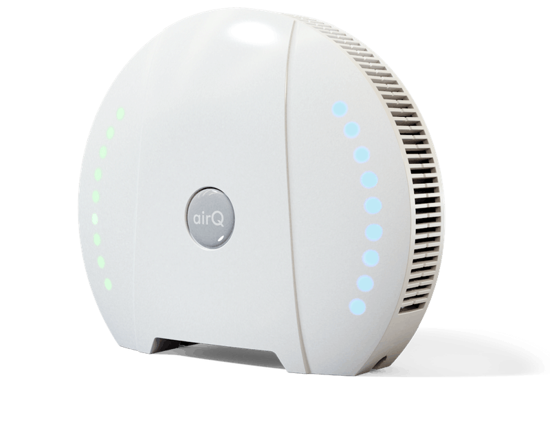

# air-Q Binding

The air-Q Binding integrates the air analyzer [air-Q](http://www.air-q.com) device into the openHAB system.

With the binding, it is possible to subscribe to supported measurement and configuration data delivered by the air-Q device.



## Supported Things

Only one Thing is supported: The `airq` device.
This Binding was tested with an `air-Q Pro` device with 14 sensors. It also works with an `air-Q` device with 11 sensors.

## Discovery

air-Q devices on the local network are discovered automatically via mDNS.
Discovered devices appear in the openHAB Inbox.
To add a discovered device, click **OK → EDIT** in the Inbox dialog, then enter the device password in the Configuration section and save.
The device IP address is filled in automatically by discovery.

If auto-discovery does not work (e.g. due to network segmentation), you can still add the device manually using its IP address.

## Thing Configuration

The air-Q Thing must be configured with:

| Parameter                 | Description                                                               | Required                       |
|---------------------------|---------------------------------------------------------------------------|--------------------------------|
| ipAddress                 | Network address, e.g. 192.168.0.68                                        | Yes (auto-filled by discovery) |
| password                  | Password of the air-Q device                                              | Yes                            |
| removeUnsupportedChannels | Remove the channels of measurements and settings the device does not have | No (default `true`)            |

The Thing provides the following properties:

| Parameter         | Description                     |
|-------------------|---------------------------------|
| id                | Device ID                       |
| hardwareVersion   | Hardware version                |
| softwareVersion   | Firmware version                |
| sensorList        | Available sensors               |
| sensorInfo        | Information about the sensors   |
| industry          | Industry version                |
| deviceType        | Product type, e.g. airQ Select  |
| serialNumber      | Serial number                   |

## Channels

The available sensor data depends on the air-Q model and installed sensor package.
The binding reads the installed sensors and the settings from the device and removes the channels it does not have.
They are added again when the device reports them, for example after a sensor was added; Item links are kept.
Event channels such as `events#door-event` are added once the device sends the event.
If the device does not report its sensors, all channels are kept.
Set `removeUnsupportedChannels` to `false` to keep all channels.
This includes also the Maximum Error per sensor value.
Deprecated flat Maximum Error channels use the `_maxerr` suffix; grouped channels use `-maxerr`.
Channels are grouped into Status (read-only device state), Measurements, Events, Maximum Errors, and Settings (device configuration).
Grouped channel IDs use lowercase words separated by hyphens, for example `settings#night-mode-start-day` and `measurements#humidity-relative`.

Existing Things retain their flat channels and Item links when upgraded to Thing version 5.
Flat channels are deprecated; use the grouped channels for new configurations and migrate existing Item links.
Those channels continue receiving states, including their legacy time representations.
To use grouped channels, update the Item links explicitly; links are not automatically moved to the new channel UIDs.
The binding logs a deprecation notice during initialization if flat channels are present.

The rw column is empty if the channel is only readable, w if the channel can be written and rw if it allows both to be read and written.

### Status

| channel                    | type                               | rw    | description                                                                              |
|----------------------------|------------------------------------|-------|------------------------------------------------------------------------------------------|
| status                     | String                             |       | OK, or a message for each sensor without reliable data, e.g. during the warm-up phase    |
| uptime                     | Number:Time                        |       | Uptime                                                                                   |
| boots                      | String                             |       | Not documented by the manufacturer                                                       |
| timestamp                  | DateTime                           |       | Time of the last measurement                                                             |
| measure-time               | Number:Time                        |       | Duration of one measurement cycle; grows with the number of sensors                      |
| daytime                    | Switch                             |       | ON while the device is in day operation, OFF while it is in night operation              |
| initial-cal-finished       | Switch                             |       | Initial Calibration Done                                                                 |
| user-calib                 | String                             |       | Last user calibration of each sensor, as "sensor: offset=value [dd.MM.yyyy HH:mm:ss]"    |
| wifi-rssi                  | Number:Power                       |       | Signal strength of the Wi-Fi connection, UNDEF while not connected                       |
| wlan-config-ssid           | String                             |       | Connected WLAN SSID                                                                      |
| wlan-config-ip-address     | String                             |       | Assigned IP Address                                                                      |
| wlan-config-net-mask       | String                             |       | Network Mask                                                                             |
| wlan-config-gateway        | String                             |       | Network Gateway                                                                          |
| wlan-config-mac            | String                             |       | MAC Address                                                                              |
| wlan-config-bssid          | String                             |       | MAC address of the access point the device is connected to                               |
| cloud-connection           | String                             |       | State of the connection to the air-Q Cloud, e.g. DISCONNECTED                            |

### Measurements

| channel                    | type                               | rw    | description                                                                              |
|----------------------------|------------------------------------|-------|------------------------------------------------------------------------------------------|
| temperature                | Number:Temperature                 |       | Temperature                                                                              |
| humidity-relative          | Number:Dimensionless               |       | Humidity                                                                                 |
| humidity-absolute          | Number:Density                     |       | Mass of water vapour per volume of air                                                   |
| dewpt                      | Number:Temperature                 |       | Dew Point                                                                                |
| d-hdt                      | Number                             |       | Change of the absolute humidity in mg/m³/s                                               |
| pressure                   | Number:Pressure                    |       | Absolute air pressure at the location of the device                                      |
| pressure-rel               | Number:Pressure                    |       | Air pressure reduced to sea level (QNH); requires the altitude setting                   |
| health-index               | Number:Dimensionless               |       | 0 to 100 % for a normal rating, -20 % during a gas alarm and -80 % during a fire alarm   |
| health                     | Number                             |       | 0 to 1000 for a normal rating, -200 during a gas alarm and -800 during a fire alarm      |
| performance-index          | Number:Dimensionless               |       | 0 to 100 % for a normal rating                                                           |
| performance                | Number                             |       | 0 to 1000 for a normal rating                                                            |
| virus-free                 | Number:Dimensionless               |       | Aerosol load with CO₂ as indicator; 100 % is fine, 0 % means insufficient ventilation    |
| mold-free                  | Number:Dimensionless               |       | Mold risk from the long-term humidity; 100 % is fine, 0 % means insufficient ventilation |
| co2                        | Number:Dimensionless               |       | Carbon Dioxide (CO₂)                                                                     |
| d-co2dt                    | Number                             |       | Change of the CO₂ concentration in ppb/s; 0 during the first 200 seconds                 |
| tvoc                       | Number:Dimensionless               |       | Volatile Organic Compounds (VOC)                                                         |
| tvoc-ionsc                 | Number:Dimensionless               |       | VOC measured with the ION Science PID sensor                                             |
| co                         | Number:Density                     |       | Carbon Monoxide (CO)                                                                     |
| no2                        | Number:Density                     |       | Nitrogen Dioxide (NO₂)                                                                   |
| o3                         | Number:Density                     |       | Ozone (O₃)                                                                               |
| o2                         | Number:Dimensionless               |       | Oxygen (O₂)                                                                              |
| so2                        | Number:Density                     |       | Sulfur Dioxide (SO₂)                                                                     |
| h2s                        | Number:Density                     |       | Hydrogen Sulfide (H₂S)                                                                   |
| c2h4o                      | Number:Density                     |       | Acetaldehyde (C2H4O)                                                                     |
| nh3-mr100                  | Number:Density                     |       | Ammonia (NH3)                                                                            |
| ash3                       | Number:Density                     |       | Arsine (AsH3)                                                                            |
| br2                        | Number:Density                     |       | Bromine (Br2)                                                                            |
| ch4s                       | Number:Density                     |       | Methanethiol (CH4S)                                                                      |
| cl2-m20                    | Number:Density                     |       | Chlorine (Cl2)                                                                           |
| clo2                       | Number:Density                     |       | Chlorine Dioxide (ClO2)                                                                  |
| cs2                        | Number:Density                     |       | Carbon Disulfide (CS2)                                                                   |
| ethanol                    | Number:Density                     |       | Ethanol                                                                                  |
| c2h4                       | Number:Density                     |       | Ethylene (C2H4)                                                                          |
| ch2o-m10                   | Number:Density                     |       | Formaldehyde (CH2O)                                                                      |
| f2                         | Number:Density                     |       | Fluorine (F2)                                                                            |
| hcl                        | Number:Density                     |       | Hydrochloric Acid (HCl)                                                                  |
| hcn                        | Number:Density                     |       | Hydrogen Cyanide (HCN)                                                                   |
| hf                         | Number:Density                     |       | Hydrogen Fluoride (HF)                                                                   |
| h2-m1000                   | Number:Density                     |       | Hydrogen (H2)                                                                            |
| h2o2                       | Number:Density                     |       | Hydrogen Peroxide (H2O2)                                                                 |
| n2o                        | Number:Density                     |       | Nitrous Oxide (N2O)                                                                      |
| no-m250                    | Number:Density                     |       | Nitrogen Monoxide (NO)                                                                   |
| acid-m100                  | Number:Dimensionless               |       | Organic Acid                                                                             |
| ph3                        | Number:Density                     |       | Hydrogen Phosphide (PH3)                                                                 |
| sih4                       | Number:Density                     |       | Silane (SiH4)                                                                            |
| ch4-mipex                  | Number:Dimensionless               |       | Methane (CH4)                                                                            |
| c3h8-mipex                 | Number:Dimensionless               |       | Propane (C3H8)                                                                           |
| r32                        | Number:Dimensionless               |       | Refrigerant R32                                                                          |
| r454b                      | Number:Dimensionless               |       | Refrigerant R454B                                                                        |
| r454c                      | Number:Dimensionless               |       | Refrigerant R454C                                                                        |
| radon                      | Number:RadiationSpecificActivity   |       | Radon                                                                                    |
| fine-dust-conc01           | Number:Density                     |       | Mass concentration of particles up to 1 µm                                               |
| fine-dust-conc02-5         | Number:Density                     |       | Mass concentration of particles up to 2.5 µm                                             |
| fine-dust-conc10           | Number:Density                     |       | Mass concentration of particles up to 10 µm                                              |
| fine-dust-cnt00-3          | Number:Dimensionless               |       | Number of particles larger than 0.3 µm per 100 ml of air                                 |
| fine-dust-cnt00-5          | Number:Dimensionless               |       | Number of particles larger than 0.5 µm per 100 ml of air                                 |
| fine-dust-cnt01            | Number:Dimensionless               |       | Number of particles larger than 1 µm per 100 ml of air                                   |
| fine-dust-cnt02-5          | Number:Dimensionless               |       | Number of particles larger than 2.5 µm per 100 ml of air                                 |
| fine-dust-cnt05            | Number:Dimensionless               |       | Number of particles larger than 5 µm per 100 ml of air                                   |
| fine-dust-cnt10            | Number:Dimensionless               |       | Number of particles larger than 10 µm per 100 ml of air                                  |
| avg-fine-dust-size         | Number:Length                      |       | Average Size of Fine Dust                                                                |
| pm1-sps30                  | Number:Density                     |       | Mass concentration of particles up to 1 µm, measured by the optional SPS30 sensor        |
| pm2-5-sps30                | Number:Density                     |       | Mass concentration of particles up to 2.5 µm, measured by the optional SPS30 sensor      |
| pm4-sps30                  | Number:Density                     |       | Mass concentration of particles up to 4 µm, measured by the optional SPS30 sensor        |
| pm10-sps30                 | Number:Density                     |       | Mass concentration of particles up to 10 µm, measured by the optional SPS30 sensor       |
| cnt0-5-sps30               | Number                             |       | Number of particles larger than 0.5 µm per cm³, measured by the optional SPS30 sensor    |
| cnt1-sps30                 | Number                             |       | Number of particles larger than 1 µm per cm³, measured by the optional SPS30 sensor      |
| cnt2-5-sps30               | Number                             |       | Number of particles larger than 2.5 µm per cm³, measured by the optional SPS30 sensor    |
| cnt4-sps30                 | Number                             |       | Number of particles larger than 4 µm per cm³, measured by the optional SPS30 sensor      |
| cnt10-sps30                | Number                             |       | Number of particles larger than 10 µm per cm³, measured by the optional SPS30 sensor     |
| avg-fine-dust-size-sps30   | Number:Length                      |       | Mean particle size, measured by the optional SPS30 sensor                                |
| sound                      | Number:Dimensionless               |       | A-weighted sound level, averaged                                                         |
| sound-max                  | Number:Dimensionless               |       | Maximum noise in the data rate interval; shows short loud events that averaging hides    |
| flow1                      | Number:VolumetricFlowRate          |       | In standard litres per minute at 20 °C and 1013 hPa                                      |
| flow2                      | Number:VolumetricFlowRate          |       | In standard litres per minute at 20 °C and 1013 hPa                                      |
| flow3                      | Number:VolumetricFlowRate          |       | In standard litres per minute at 20 °C and 1013 hPa                                      |
| flow4                      | Number:VolumetricFlowRate          |       | In standard litres per minute at 20 °C and 1013 hPa                                      |

### Events

| channel                    | type                               | rw    | description                                                                              |
|----------------------------|------------------------------------|-------|------------------------------------------------------------------------------------------|
| fire-alarm-active          | Switch                             |       | ON while the device raises a fire alarm, UNDEF while the fire alarm is disabled          |
| gas-alarm-active           | Switch                             |       | ON while the device raises a gas alarm, UNDEF while the gas alarm is disabled            |
| door-event                 | Number                             |       | Experimental, may not be reliable; requires advanced data processing                     |
| window-event               | Number                             |       | Experimental, may not be reliable; requires advanced data processing                     |
| window-open                | Number                             |       | Experimental, may not be reliable; requires advanced data processing                     |
| person                     | Number                             |       | Experimental, may not be reliable; requires advanced data processing                     |

### Maximum Errors

Each measurement with a worst-case error (±) has an advanced error channel `maxerr#<channel>-maxerr`, for example `maxerr#co2-maxerr`.
Each `-maxerr` channel has the Item type and unit of its measurement, for example `ch2o-m10-maxerr` contains the worst-case error of the formaldehyde measurement in µg/m³.
Temperature and dew point errors are temperature differences in K.
For maximum noise, the error channel is `sound-max-maxerr`, distinct from `sound-maxerr` of the noise.

### Settings

| channel                    | type                               | rw    | description                                                                              |
|----------------------------|------------------------------------|-------|------------------------------------------------------------------------------------------|
| device-name                | String                             | rw    | Device Name                                                                              |
| room-type                  | String                             | rw    | Helps the device recognise situations typical for the room                               |
| room-height                | Number:Length                      | rw    | Used by the advanced data processing, 0 if not set                                       |
| room-area                  | Number:Area                        | rw    | Used by the advanced data processing, 0 if not set                                       |
| location                   | Location                           | rw    | Location of air-Q Device                                                                 |
| altitude                   | Number:Length                      | rw    | Height above sea level for the relative pressure, UNDEF if not set; needs a restart      |
| altitude-error             | Number:Length                      | rw    | Estimated error of the altitude                                                          |
| country-code               | String                             | rw    | Time zone for the summer/winter time switch in night mode, and the cloud endpoint        |
| time-server                | String                             | rw    | NTP server the device synchronises its clock with every six hours                        |
| log-level                  | String                             | w     | Detail of the device log on the SD card: Error, Warning or Info                          |
| wifi                       | Switch                             |       | Read-only, so the device cannot be taken off the network                                 |
| ssid                       | String                             |       | Networks the device connects to; add networks with the setWifi action                    |
| wifi-info                  | Switch                             | rw    | Show WLAN Status with LED                                                                |
| night-mode-activated       | Switch                             | rw    | Whether the night mode is used; the other night mode settings are kept while it is off   |
| night-mode-start-day       | Number:Time                        | rw    | Minutes since midnight UTC at which day operation starts                                 |
| night-mode-start-night     | Number:Time                        | rw    | Minutes since midnight UTC at which night operation starts                               |
| night-mode-brightness-day  | Number                             | rw    | 0 (off) to 10                                                                            |
| night-mode-brightness-night| Number                             | rw    | 0 (off) to 10                                                                            |
| night-mode-fan-night-off   | Switch                             | rw    | Switch Off Fan at Night                                                                  |
| night-mode-wifi-night-off  | Switch                             | rw    | The device cannot be reached at night; the cloud upload is buffered until the morning    |
| night-mode-alarm-night-off | Switch                             | rw    | Suppresses the acoustic signals at night; fire and gas alarms are still given            |
| night-mode-last-time-switch| Number                             |       | Not documented by the manufacturer                                                       |
| fire-alarm-enabled         | Switch                             | rw    | Alarm for CO above 200 mg/m³, PM1 above 400 µg/m³ or a temperature above 70 °C           |
| gas-alarm-enabled          | Switch                             | rw    | Alarm for concentrations hazardous to health, e.g. O₂ below 13 % or NO₂ above 20 mg/m³   |
| alarm-forwarding           | Switch                             | rw    | Forwards fire and gas alarms to the other air-Q devices in the household                 |
| sound-info                 | String                             |       | Acoustic signals for thresholds, with frequency, volume, duration and repetition         |
| averaging                  | Number                             | rw    | Number of measurements the device averages over; 1 disables averaging (default 30)       |
| averaging-rhythm           | Number:Time                        | rw    | Interval at which the current average is stored and uploaded to the cloud                |
| power-freq-suppression     | String                             | rw    | Mains frequency filter for noise and gas sensors: 50Hz, 60Hz or 50Hz+60Hz                |
| auto-drift-compensation    | Switch                             | rw    | Compensates the slow drift of the sensors over time and from high humidity               |
| advanced-data-processing   | Switch                             | rw    | Enables the detection of events such as open windows or persons                          |
| building-standard          | String                             | rw    | VOC evaluation according to a building standard: None, WELL or RESET                     |
| ppm-and-ppb                | Switch                             | rw    | Deprecated: CO in ppm, NO₂, O₃ and SO₂ in ppb, unless units are configured on the device |
| warmup-phase               | Switch                             | rw    | ON while the gas and VOC sensors warm up, up to 60 minutes after power-on; OFF ends it   |
| cloud-upload               | Switch                             | rw    | Upload to air-Q Cloud                                                                    |
| auto-update                | Number:Time                        | rw    | Days between automatic firmware updates, 0 = off (default 90); an update restarts it     |

Measurements are reported in the units configured on the device (`units`, or the deprecated `ppm&ppb`) and converted to the channel's unit.
Gas concentrations are converted between ppm, ppb or % and mg/m³ or µg/m³ with the sensor's molar mass and the measured temperature and pressure.

These channels support scalar readings as well as `[value, error]` pairs; for scalars, the error channel is `UNDEF`.
Absent readings for these channels are silently ignored, since not every device has every sensor.
Explicit `null` or malformed readings set these measurements and their error channels to `UNDEF` and recover on the next valid reading.
Other legacy measurement conversions retain their existing behavior.

Day/night start channels use minutes (`min`) since midnight UTC, from 0 to 1439; for example, 480 min corresponds to 08:00.
The binding converts these numeric values to and from the device's `HH:mm` representation.
Time commands accept quantities in compatible units or plain integers in the channel's hinted unit.
Day/night times require whole minutes, and averaging delay requires whole non-negative seconds.
Power-frequency suppression is a String setting accepting `50Hz`, `60Hz`, or `50Hz+60Hz`.

Set the linked TVOC Item's `unit` metadata to `ppb`.
Without it, a `Number:Dimensionless` Item can store the reading in unit `one`: 2353 ppb becomes 0.000002353 and may display as zero when rounded.

### Reporting Missing Measurements

To diagnose unsupported data points, enable trace logging in the openHAB console:

```shell
log:set TRACE org.openhab.binding.airq
```

Look for `Received measurement data` entries after the next poll.
These include numeric values for known measurements and the names of other received fields with their values replaced by `<omitted>`.
Passwords, device identifiers, location, configuration, free-form status text, and unknown values are not included.
Malformed responses are not logged verbatim either.
Include a sanitized trace entry and your device's sensor package when reporting a missing measurement.
Restore normal logging afterwards:

```shell
log:set DEFAULT org.openhab.binding.airq
```

## Actions

The binding registers the [Thing Action](https://www.openhab.org/docs/configuration/rules-dsl.html#thing-actions) `setWifi` under the `airq` scope.
It adds a Wi-Fi network to the air-Q and returns `true` if the device accepted it.

| Parameter          | Description                                                                                          |
|--------------------|------------------------------------------------------------------------------------------------------|
| `String ssid`      | Name of the network, 1 to 32 bytes                                                                   |
| `String password`  | Wi-Fi key, empty for an unsecured network                                                            |
| `String bssid`     | Optional access point address as 12 hex digits, e.g. `a0c86d65ee71`; `null` or empty to omit it      |
| `boolean hidden`   | Whether the network is hidden                                                                        |
| `boolean restart`  | Whether the air-Q restarts to connect; otherwise it remembers the network and stays connected        |

::: warning
Wrong credentials together with `restart` take the air-Q off the network.
openHAB can then no longer reach it, and it can only be set up again with the air-Q app or its hotspot.
For the same reason, the binding does not switch Wi-Fi off.
:::

```java
val airqActions = getActions("airq", "airq:airq:1")
val accepted = airqActions.setWifi("Your Wifi SSID", "Your Wifi key", null, false, true)
```

## Usage with Docker

This binding requires the JVM cryptographic strength policy to be set to "unlimited".
Otherwise the connection to the device will fail.
See the [openHAB Docker image documentation](https://github.com/openhab/openhab-docker/blob/main/README.md#java-cryptographic-strength-policy) for details.

## Example

### air-Q.things

```java
Thing airq:airq:1 "air-Q" [ ipAddress="192.168.0.68", password="myAirQPassword" ]
```

### air-Q.items

```java
String                airQ_status                   "Status of Sensors"                                    {channel="airq:airq:1:status#status"}
Number:Time           airQ_uptime                   "Uptime"                                               {unit="s",channel="airq:airq:1:status#uptime"}
String                airQ_boots                    "Boot Counters"                                        {channel="airq:airq:1:status#boots"}
DateTime              airQ_timestamp                "Time Stamp [%1$td.%1$tm.%1$tY %1$tH:%1$tM]"           {channel="airq:airq:1:status#timestamp"}
Number:Time           airQ_measureTime              "Time Needed for Measurement"                          {unit="ms",channel="airq:airq:1:status#measure-time"}
Switch                airQ_daytime                  "Day Operation"                                        {channel="airq:airq:1:status#daytime"}
Switch                airQ_initialCalFinished       "Initial Calibration Done"                             {channel="airq:airq:1:status#initial-cal-finished"}
String                airQ_userCalib                "Last Sensor Calibration"                              {channel="airq:airq:1:status#user-calib"}
Number:Power          airQ_wifiRssi                 "Wi-Fi Signal Strength"                                {channel="airq:airq:1:status#wifi-rssi"}
String                airQ_WLAN_config_SSID         "Connected WLAN SSID"                                  {channel="airq:airq:1:status#wlan-config-ssid"}
String                airQ_WLAN_config_IPAddress    "Assigned IP Address"                                  {channel="airq:airq:1:status#wlan-config-ip-address"}
String                airQ_WLAN_config_netMask      "Network Mask"                                         {channel="airq:airq:1:status#wlan-config-net-mask"}
String                airQ_WLAN_config_gateway      "Network Gateway"                                      {channel="airq:airq:1:status#wlan-config-gateway"}
String                airQ_WLAN_config_MAC          "MAC Address"                                          {channel="airq:airq:1:status#wlan-config-mac"}
String                airQ_WLAN_config_BSSID        "Network BSSID"                                        {channel="airq:airq:1:status#wlan-config-bssid"}
String                airQ_cloudConnection          "Cloud Connection"                                     {channel="airq:airq:1:status#cloud-connection"}

Number:Temperature    airQ_temperature              "Temperature"                                          {channel="airq:airq:1:measurements#temperature"}
Number:Dimensionless  airQ_humidityRelative         "Humidity"                                             {channel="airq:airq:1:measurements#humidity-relative"}
Number:Density        airQ_humidityAbsolute         "Absolute Humidity"                                    {channel="airq:airq:1:measurements#humidity-absolute"}
Number:Temperature    airQ_dewpt                    "Dew Point"                                            {channel="airq:airq:1:measurements#dewpt"}
Number                airQ_dHdt                     "Change of Humidity"                                   {channel="airq:airq:1:measurements#d-hdt"}
Number:Pressure       airQ_pressure                 "Barometric Pressure"                                  {channel="airq:airq:1:measurements#pressure"}
Number                airQ_health                   "Health Index Raw"                                     {channel="airq:airq:1:measurements#health"}
Number                airQ_performance              "Performance Index Raw"                                {channel="airq:airq:1:measurements#performance"}
Number:Dimensionless  airQ_Virus_free               "Virus-Free Index"                                     {unit="%",channel="airq:airq:1:measurements#virus-free"}
Number:Dimensionless  airQ_Mold_free                "Mold-Free Index"                                      {unit="%",channel="airq:airq:1:measurements#mold-free"}
Number:Dimensionless  airQ_co2                      "Carbon Dioxide (CO₂)"                                 {channel="airq:airq:1:measurements#co2"}
Number                airQ_dCO2dt                   "Change of CO₂ Concentration"                          {channel="airq:airq:1:measurements#d-co2dt"}
Number:Dimensionless  airQ_voc                      "Volatile Organic Compounds (VOC)"                     {unit="ppb",channel="airq:airq:1:measurements#tvoc"}
Number                airQ_co                       "Carbon Monoxide (CO)"                                 {channel="airq:airq:1:measurements#co"}
Number:Density        airQ_no2                      "Nitrogen Dioxide (NO₂)"                               {channel="airq:airq:1:measurements#no2"}
Number:Density        airQ_o3                       "Ozone (O₃)"                                           {channel="airq:airq:1:measurements#o3"}
Number:Dimensionless  airQ_o2                       "Oxygen (O₂)"                                          {channel="airq:airq:1:measurements#o2"}
Number:Density        airQ_so2                      "Sulfur Dioxide (SO₂)"                                 {channel="airq:airq:1:measurements#so2"}
Number:RadiationSpecificActivity airQ_radon                    "Radon"                                                {channel="airq:airq:1:measurements#radon"}
Number:Density        airQ_fineDustConc01           "Fine Dust 1 µm"                                       {channel="airq:airq:1:measurements#fine-dust-conc01"}
Number:Density        airQ_fineDustConc02_5         "Fine Dust 2.5 µm"                                     {channel="airq:airq:1:measurements#fine-dust-conc02-5"}
Number:Density        airQ_fineDustConc10           "Fine Dust 10 µm"                                      {channel="airq:airq:1:measurements#fine-dust-conc10"}
Number:Dimensionless  airQ_fineDustCnt00_3          "Fine Dust Count 0.3 µm"                               {channel="airq:airq:1:measurements#fine-dust-cnt00-3"}
Number:Dimensionless  airQ_fineDustCnt00_5          "Fine Dust Count 0.5 µm"                               {channel="airq:airq:1:measurements#fine-dust-cnt00-5"}
Number:Dimensionless  airQ_fineDustCnt01            "Fine Dust Count 1 µm"                                 {channel="airq:airq:1:measurements#fine-dust-cnt01"}
Number:Dimensionless  airQ_fineDustCnt02_5          "Fine Dust Count 2.5 µm"                               {channel="airq:airq:1:measurements#fine-dust-cnt02-5"}
Number:Dimensionless  airQ_fineDustCnt05            "Fine Dust Count 5 µm"                                 {channel="airq:airq:1:measurements#fine-dust-cnt05"}
Number:Dimensionless  airQ_fineDustCnt10            "Fine Dust Count 10 µm"                                {channel="airq:airq:1:measurements#fine-dust-cnt10"}
Number:Length         airQ_avgFineDustSize          "Average Size of Fine Dust"                            {channel="airq:airq:1:measurements#avg-fine-dust-size"}
Number:Dimensionless  airQ_sound                    "Noise"                                                {channel="airq:airq:1:measurements#sound"}

Switch                airQ_fireAlarmActive          "Fire Alarm Active"                                    {channel="airq:airq:1:events#fire-alarm-active"}
Switch                airQ_gasAlarmActive           "Gas Alarm Active"                                     {channel="airq:airq:1:events#gas-alarm-active"}
Number                airQ_doorEvent                "Door Event"                                           {channel="airq:airq:1:events#door-event"}
Number                airQ_windowEvent              "Window Event"                                         {channel="airq:airq:1:events#window-event"}
Number                airQ_windowOpen               "Window Open"                                          {channel="airq:airq:1:events#window-open"}
Number                airQ_person                   "Person"                                               {channel="airq:airq:1:events#person"}

Number:Temperature    airQ_temperature_maxerr       "Max. Error Temperature"                               {unit="K",channel="airq:airq:1:maxerr#temperature-maxerr"}
Number:Dimensionless  airQ_humidity_maxerr          "Max. Error Humidity"                                  {channel="airq:airq:1:maxerr#humidity-relative-maxerr"}
Number:Density        airQ_humidity_abs_maxerr      "Max. Error Abs. Humidity"                             {channel="airq:airq:1:maxerr#humidity-absolute-maxerr"}
Number:Temperature    airQ_dewpt_maxerr             "Max. Error Dew Point"                                 {unit="K",channel="airq:airq:1:maxerr#dewpt-maxerr"}
Number:Pressure       airQ_pressure_maxerr          "Max. Error Pressure"                                  {channel="airq:airq:1:maxerr#pressure-maxerr"}
Number:Dimensionless  airQ_virus_free_maxerr        "Max. Error Virus-Free"                                {unit="%",channel="airq:airq:1:maxerr#virus-free-maxerr"}
Number:Dimensionless  airQ_mold_free_maxerr         "Max. Error Mold-Free"                                 {unit="%",channel="airq:airq:1:maxerr#mold-free-maxerr"}
Number:Dimensionless  airQ_co2_maxerr               "Max. Error CO₂ Conc."                                 {channel="airq:airq:1:maxerr#co2-maxerr"}
Number:Dimensionless  airQ_voc_maxerr               "Max. Error VOC Conc."                                 {channel="airq:airq:1:maxerr#tvoc-maxerr"}
Number:Density        airQ_no2_maxerr               "Max. Error NO₂ Conc."                                 {channel="airq:airq:1:maxerr#no2-maxerr"}
Number:Density        airQ_o3_maxerr                "Max. Error O₃ Conc."                                  {channel="airq:airq:1:maxerr#o3-maxerr"}
Number:Dimensionless  airQ_oxygen_maxerr            "Max. Error Oxygen Conc."                              {channel="airq:airq:1:maxerr#o2-maxerr"}
Number:Density        airQ_so2_maxerr               "Max. Error SO₂ Conc."                                 {channel="airq:airq:1:maxerr#so2-maxerr"}
Number:Density        airQ_pm1_maxerr               "Max. Error Fine Dust 1 µm"                            {channel="airq:airq:1:maxerr#fine-dust-conc01-maxerr"}
Number:Density        airQ_pm2_5_maxerr             "Max. Error Fine Dust 2.5 µm"                          {channel="airq:airq:1:maxerr#fine-dust-conc02-5-maxerr"}
Number:Density        airQ_pm10_maxerr              "Max. Error Fine Dust 10 µm"                           {channel="airq:airq:1:maxerr#fine-dust-conc10-maxerr"}
Number:Dimensionless  airQ_cnt03_maxerr             "Max. Error Fine Dust Count 0.3 µm"                    {channel="airq:airq:1:maxerr#fine-dust-cnt00-3-maxerr"}
Number:Dimensionless  airQ_cnt05_maxerr             "Max. Error Fine Dust Count 0.5 µm"                    {channel="airq:airq:1:maxerr#fine-dust-cnt00-5-maxerr"}
Number:Dimensionless  airQ_cnt1_maxerr              "Max. Error Fine Dust Count 1 µm"                      {channel="airq:airq:1:maxerr#fine-dust-cnt01-maxerr"}
Number:Dimensionless  airQ_cnt25_maxerr             "Max. Error Fine Dust Count 2.5 µm"                    {channel="airq:airq:1:maxerr#fine-dust-cnt02-5-maxerr"}
Number:Dimensionless  airQ_cnt5_maxerr              "Max. Error Fine Dust Count 5 µm"                      {channel="airq:airq:1:maxerr#fine-dust-cnt05-maxerr"}
Number:Dimensionless  airQ_cnt10_maxerr             "Max. Error Fine Dust Count 10 µm"                     {channel="airq:airq:1:maxerr#fine-dust-cnt10-maxerr"}
Number:Dimensionless  airQ_sound_maxerr             "Max. Error Noise"                                     {channel="airq:airq:1:maxerr#sound-maxerr"}

String                airQ_deviceName               "Device Name"                                          {channel="airq:airq:1:settings#device-name"}
String                airQ_roomType                 "Room Type"                                            {channel="airq:airq:1:settings#room-type"}
Number:Length         airQ_roomHeight               "Room Height"                                          {unit="m",channel="airq:airq:1:settings#room-height"}
Number:Area           airQ_roomArea                 "Room Area"                                            {unit="m²",channel="airq:airq:1:settings#room-area"}
Location              airQ_location                 "Location of air-Q Device"                             {channel="airq:airq:1:settings#location"}
Number:Length         airQ_altitude                 "Altitude"                                             {unit="m",channel="airq:airq:1:settings#altitude"}
Number:Length         airQ_altitudeError            "Altitude Error"                                       {unit="m",channel="airq:airq:1:settings#altitude-error"}
String                airQ_countryCode              "Country"                                              {channel="airq:airq:1:settings#country-code"}
String                airQ_timeServer               "Time Server"                                          {channel="airq:airq:1:settings#time-server"}
String                airQ_logLevel                 "Logging Level"                                        {channel="airq:airq:1:settings#log-level"}
Switch                airQ_wifi                     "Use WLAN"                                             {channel="airq:airq:1:settings#wifi"}
String                airQ_SSID                     "Configured WLAN Networks"                             {channel="airq:airq:1:settings#ssid"}
Switch                airQ_wifiInfo                 "Show WLAN Status with LED"                            {channel="airq:airq:1:settings#wifi-info"}
Switch                airQ_nightMode_activated      "Night Mode"                                           {channel="airq:airq:1:settings#night-mode-activated"}
Number:Time           airQ_nightMode_startDay       "Start of Day Operation"                               {unit="min",channel="airq:airq:1:settings#night-mode-start-day"}
Number:Time           airQ_nightMode_startNight     "End of Day Operation"                                 {unit="min",channel="airq:airq:1:settings#night-mode-start-night"}
Number                airQ_nightMode_brightnessDay  "Day Brightness of LED"                                {channel="airq:airq:1:settings#night-mode-brightness-day"}
Number                airQ_nightMode_brightnessNight "Night Brightness of LED"                              {channel="airq:airq:1:settings#night-mode-brightness-night"}
Switch                airQ_nightMode_fanNightOff    "Switch Off Fan at Night"                              {channel="airq:airq:1:settings#night-mode-fan-night-off"}
Switch                airQ_nightMode_wifiNightOff   "Switch Off WLAN at Night"                             {channel="airq:airq:1:settings#night-mode-wifi-night-off"}
Switch                airQ_nightMode_alarmNightOff  "Switch Off Acoustic Signals at Night"                 {channel="airq:airq:1:settings#night-mode-alarm-night-off"}
Number                airQ_nightMode_lastTimeSwitch "Last Summer/Winter Time Switch"                       {channel="airq:airq:1:settings#night-mode-last-time-switch"}
Switch                airQ_fireAlarmEnabled         "Fire Alarm Enabled"                                   {channel="airq:airq:1:settings#fire-alarm-enabled"}
Switch                airQ_gasAlarmEnabled          "Gas Alarm Enabled"                                    {channel="airq:airq:1:settings#gas-alarm-enabled"}
Switch                airQ_alarmForwarding          "Share Alarms With Other air-Q"                        {channel="airq:airq:1:settings#alarm-forwarding"}
String                airQ_soundInfo                "Sound Info"                                           {channel="airq:airq:1:settings#sound-info"}
Number                airQ_averaging                "Averaging Window"                                     {channel="airq:airq:1:settings#averaging"}
Number:Time           airQ_averagingRhythm          "Data Rate"                                            {unit="s",channel="airq:airq:1:settings#averaging-rhythm"}
String                airQ_powerFreqSuppression     "Power Frequency"                                      {channel="airq:airq:1:settings#power-freq-suppression"}
Switch                airQ_autoDriftCompensation    "Compensate Automatic Drift"                           {channel="airq:airq:1:settings#auto-drift-compensation"}
Switch                airQ_advancedDataProcessing   "Advanced Data Processing"                             {channel="airq:airq:1:settings#advanced-data-processing"}
String                airQ_buildingStandard         "Building Standard"                                    {channel="airq:airq:1:settings#building-standard"}
Switch                airQ_ppm_and_ppb              "Gases in ppm and ppb"                                 {channel="airq:airq:1:settings#ppm-and-ppb"}
Switch                airQ_warmupPhase              "Warm-up Phase"                                        {channel="airq:airq:1:settings#warmup-phase"}
Switch                airQ_cloudUpload              "Upload to air-Q Cloud"                                {channel="airq:airq:1:settings#cloud-upload"}
Number:Time           airQ_autoUpdate               "Automatic Firmware Update Interval"                   {unit="d",channel="airq:airq:1:settings#auto-update"}
```
