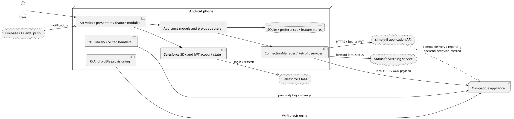
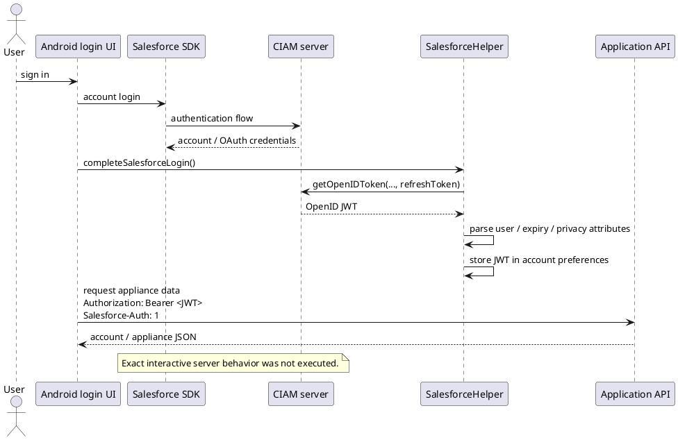
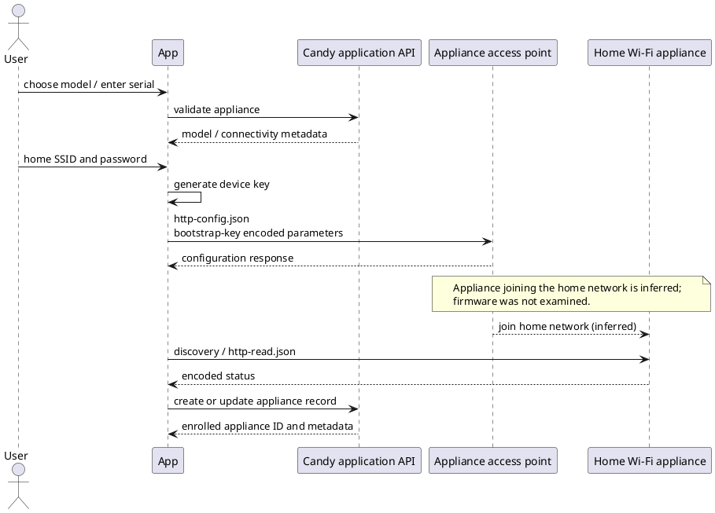
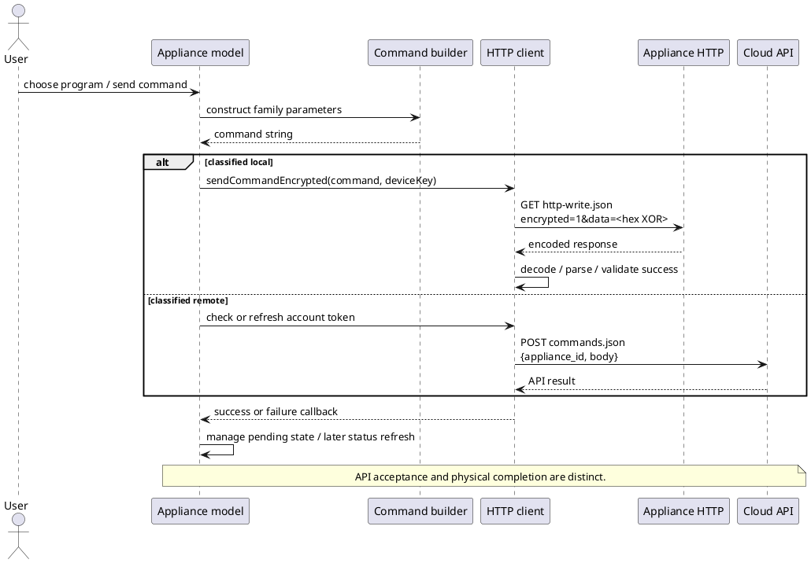
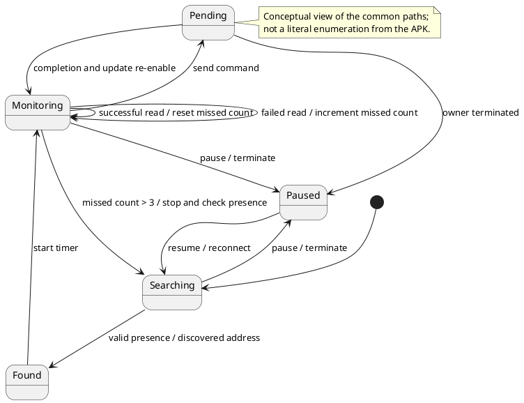
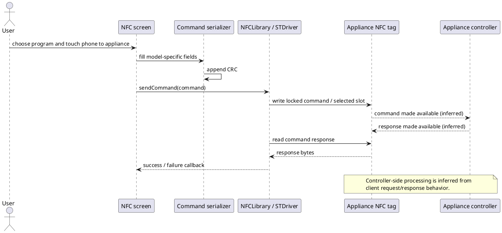

# Candy simply-Fi Android: reverse-engineering report

Analysis date: 25 October 2026. Package: `it.candy.simplyfi`. Examined release: **3.14.1, version code 226**.

For binding development, see the [Bianca protocol contract](doc/protocol.md).

## 1. Scope and confidence

This report explains the Android client's architecture, account lifecycle, appliance enrollment, local and remote control, discovery, NFC, Bluetooth provisioning, persistence, notifications, and supporting services. It is based on an actual APK decoded with the installed **Apktool 3.0.3**, followed by Java/Kotlin reconstruction with **JADX 1.5.6** and inspection of selected Smali instructions and bundled databases.

This is a static analysis of one release. No Candy account was supplied, no appliance was connected, and the app was not executed on Android. Cloud account APIs and appliance control endpoints were not called. Consequently, request construction and parsing can be established, but present server availability, acceptance of credentials, physical device behavior, and compatibility with every model cannot.

The [Google Play listing](https://play.google.com/store/apps/details?id=it.candy.simplyfi&hl=pl) identifies the requested product. The analyzed binary was obtained from a mirror because that page does not expose an APK download. Matching the package name and a valid signature does **not** independently prove identity with the binary currently delivered by Google Play.

Evidence labels used below:

- **Observed:** directly present in the examined manifest, bytecode, reconstructed source, or assets.
- **Inferred:** an architectural explanation consistent with those artifacts, but not verified through execution.
- **Unverified:** requires an account, appliance, packet capture, or additional binary analysis.

References such as **[E7]** point to the reproducible artifact and method index in section 18. These are APK evidence references, not claims that the reconstructed files are original source code.

### 1.1 Binary identity

| Property | Measured value |
| --- | --- |
| Application ID | `it.candy.simplyfi` |
| Version name / code | `3.14.1` / `226` |
| File size | `116997283` bytes |
| SHA-256 | `35df93c6e0b5883bee8cb066ba8ef35d3ee4c5e2af164e3a6b02675821718b03` |
| MD5, for mirror comparison only | `5290844374a55c5c4851a2e3e53a6429` |
| Minimum Android API | `26`, Android 8.0 |
| Target / compile API | `35` / `35` |
| DEX files | Five: `classes.dex` through `classes5.dex` |
| Native ABIs | `armeabi-v7a`, `arm64-v8a`, `x86`, `x86_64`; library availability differs |
| APK signature verification | Valid v2 signature; v1 and v3 absent; verifier reported no errors or warnings |
| Signing certificate subject | `CN=Unknown,OU=Candy,O=Candy,L=Unknown,ST=Unknown,C=it` |
| Certificate SHA-1 | `01bd1567c3b13cc6f3e2a786b2e026ab977c581e` |
| Certificate SHA-256 | `924937bae052dc4a5a8d37c3b8af0b22ab06d970d388f633b1336bc14fb6a1c2` |

Download metadata: [Aptoide package API](https://ws75.aptoide.com/api/7/app/get/package_name=it.candy.simplyfi). Exact [APK mirror object](https://pool.apk.aptoide.com/appupdater/it-candy-simplyfi-226-74222692-5290844374a55c5c4851a2e3e53a6429.apk). The downloaded size, MD5 and certificate SHA-1 matched that metadata. Signature verification used Google's `com.android.tools.build:apksig:8.7.3`, against the downloaded bytes. [E1]

### 1.2 Decompiler limitations

Apktool completed successfully. JADX completed its processing pass with **122 decompilation errors**, returning exit code 3. Its output is useful for navigation but is not a clean, compilable recovery of the original project. Kotlin coroutines, synthetic lambdas and complex control flow are particularly susceptible to reconstruction problems.

The original decoded Smali remains the reference when reconstructed Java is incomplete or ambiguous. The report does not claim exhaustive verification of all application methods, third-party SDK internals, native code, or every appliance variant.

## 2. What the app actually does

Candy simply-Fi is a native Android application built around a shared Candy/Hoover core. It is not just a website inside an APK. The shared code contains phone/tablet activities, Java appliance models, newer Kotlin feature modules, local databases, HTTP clients and a substantial NFC implementation. [E2–E4]

The central flow is:

1. Initialize application services, analytics, account support and local state.
1. Authenticate the user, primarily through Salesforce CIAM in this release.
1. Download the user's appliances and model-specific programs/configuration.
1. Select the relevant appliance implementation using type, interface and connectivity metadata.
1. For Wi-Fi products, choose local HTTP or cloud HTTP according to network classification and model-specific service logic.
1. For NFC products, exchange commands with the appliance's NFC tag while the phone is nearby.
1. Convert the resulting protocol values into UI state, programs, warnings, statistics and notifications.

**A key distinction:** Wi-Fi, NFC and Bluetooth have different roles. Wi-Fi supports status/control locally and through the cloud. Smart Touch uses NFC proximity exchanges. The examined Bluetooth implementation provisions Wi-Fi credentials; it does not establish that Bluetooth is a general continuous remote-control transport. [E7–E13]

### 2.1 Architecture diagram

The appliance-to-cloud connection below is inferred from remote-command and status APIs; the APK does not contain appliance firmware or backend implementation.



### 2.2 Major packages and responsibilities

| Package or class | Responsibility |
| --- | --- |
| `it.candy.simplyfi` | Candy application wrapper and branded resources |
| `it.candyhoover.core.CandyApplication` | Initialization, application flags, lifecycle callbacks, account/SDK setup |
| `core.activities`, `core.home` | Login, enrollment, appliance navigation, settings and home UI |
| `core.models.appliances` | Common appliance state and legacy family-specific implementations |
| `core.models.commands`, `core.models.programs` | Wire commands and program definitions |
| `core.connectionmanager` | HTTP communication, account/appliance APIs and reachability |
| `core.washer.axibianca`, `core.dishwasher.nautilus`, `core.fridge` | Newer model-family services and feature logic |
| `core.persistence`, `core.datamanager` | Database access, caches, user data and synchronization |
| `it.haier.udp` | UDP discovery and HTTP LAN scanning |
| `it.candy.nfclibrary` | NFC commands, CRCs, NDEF records and tag access |
| `core.activities.enrollment.ble` | Bluetooth scanning, GATT connection and enrollment command |
| `core.salesforce` | CIAM integration, JWT retrieval and user mapping |
| `core.receivers`, `core.helper.clients` | Push handling and device registration |
| `core.alacarte`, `core.voicecontrol`, `it.candyhoover.clickwash` | Guided programs, voice functions and laundry recommendations |

The bundle also contains microwave, oven, hood, hob, vacuum, energy, shopping-list, warranty and consumable-related code. Presence of a module does not mean every connected appliance exposes that feature. [E3, E14, E15]

## 3. Startup, navigation and account state

### 3.1 Startup

The manifest selects `it.candyhoover.core.CandyApplication`. Its `onCreate()` installs an RxJava error handler, initializes Flurry, Firebase analytics/crash reporting, application helpers and activity lifecycle callbacks, obtains push-related state, and initializes the Salesforce SDK. `USE_ENCRYPTION` defaults to `true`. [E2, E4]

`it.candy.simplyfi.PreSplash` delegates to the shared core splash implementation. Its `initONESignal()` override is empty. This is evidence against assuming that every bundled historical notification SDK remains the active Candy notification implementation. Firebase and Huawei services are separately present. [E4, E16]

The manifest includes separate portrait/landscape activities and later feature activities. It also declares custom-scheme entry points, including `candy:` and `candysimplify:`. Their presence establishes routing capabilities, not a finding that links can bypass authentication. [E2]

### 3.2 Current authentication: Salesforce CIAM and OpenID JWT

The configured CIAM server is:

```text
https://account.candy-home.com/CandyApp
```

That URL comes from `res/xml/servers.xml`. The shared account code also has brand-specific registration URLs for Hoover and Rosières. [E5]

The decisive methods in this release are:

- `CandyDataManager.loadToken()` returns `SalesforceHelper.getJWT()` outside demo mode.
- `CandyDataManager.isTokenExpired()` delegates to Salesforce JWT expiry logic.
- `ConnectionManager.refreshToken()` invokes the Salesforce refresh path.
- `SalesforceHelper.getSalesForceJWT()` calls `OAuth2.getOpenIDToken()` using the selected login server, configured OAuth client ID and the current Salesforce account's refresh token.
- `SalesforceHelper.updateUserAccount()` parses the JWT and stores it alongside country/privacy attributes in account preferences.

Therefore, reproducing the old username/password token request alone does not reproduce the active authentication design. The exact interactive authentication pages, challenges, consent requirements and server-side policy remain unverified. [E5, E6]



### 3.3 Legacy authentication still present

`ConnectionManager.requestToken()` and `refreshTokenLegacy()` construct a password-grant form:

```text
POST https://simply-fi.herokuapp.com/oauth/token

grant_type=password
client_id=<embedded client identifier>
client_secret=<embedded value, omitted>
username=<user email>
password=<user password>
```

The parser reads `access_token`, `token_type` and `expires_in`. A separate `loadOldToken()` reads legacy cached token state. The active `refreshToken()` no longer chooses that legacy method. These methods should be treated as retained compatibility/migration code unless a specific caller establishes otherwise. No credentials or embedded secret values are reproduced here. [E6]

### 3.4 HTTP identity and metadata headers

Depending on client and overload, cloud requests add:

| Header | Meaning |
| --- | --- |
| `Authorization: Bearer <JWT>` | Current application authorization |
| `Salesforce-Auth: 1` | Indicates the Salesforce authentication path |
| `Brand` | Selected product brand |
| `Device-Family`, `Device-Model`, `Device-Os` | Android device metadata |
| `Device-Language` | Current locale language |
| `App-Version-Name`, `App-Version-Code` | App release identity |
| `Device-Token`, `Device-Id` | Push/install identity where available |
| `Fcm-Token` | Firebase token in notification registration code |
| `Old-Token-Before-Ciam` | Conditional one-time migration header |

Do not assume every client adds every header. The overloads differ, and Retrofit services have their own interceptors. Local appliance requests remove cloud authorization headers in the legacy client. [E6, E10, E16]

## 4. Appliance enrollment

### 4.1 Enrollment is model dependent

Enrollment activities collect appliance type, serial number and product data, validate the product against the cloud, select the appropriate connectivity flow, provision the appliance when needed, and persist the resulting appliance record. NFC-only enrollment is different from Wi-Fi provisioning. BLE is another Wi-Fi provisioning route. [E2, E7, E11, E12]

Useful identity fields include the cloud appliance ID, MAC address, serial number, appliance type, `interface_type`, `connectivity`, and the per-appliance XOR key. These must remain distinct: a serial number is not interchangeable with a cloud ID or MAC address. [E7, E14]

### 4.2 Wi-Fi access-point provisioning

The legacy configuration IP constant is `192.168.0.1`. The configuration request uses `http-config.json`. Its ordered plaintext parameters are:

```text
NTW_MODE=<security mode>&SSID=<home network>&PASSWORD=<Wi-Fi password>&ENCRYPT_KEY=<new device key>
```

The code defines security constants `0` for none, `2` for WEP and `3` for WPA. This records what the application supports; it is not a recommendation to use WEP. [E7]

With encryption enabled, the wire request is:

```text
GET http://<appliance-ip>/http-config.json?encrypted=1&data=<hex-XOR-encoded parameters>
```

Two keys are involved:

1. A bootstrap/configuration key derived from the appliance SSID.
1. A newly generated per-appliance key carried inside `ENCRYPT_KEY` and used for subsequent control.

`calculateEncriptionKeyForConf()` cleans the SSID according to model family, takes its final eight characters and repeats them. `getStartupKey()` instead repeats the first eight characters of the cleaned SSID. These are separate methods; they must not be merged into a single assumed algorithm. [E8]

Some newer washer families use a Retrofit `EnrollmentService` for the same configuration endpoint. Its request uses the configuration key, but its response is decrypted with the supplied appliance key. The older `configureApplianceEncrypted()` also decodes the response with the newly supplied appliance key, despite receiving a configuration-key argument as well. A replacement client must distinguish the request bootstrap key from the response/device key. [E7, E10]

### 4.3 Cloud enrollment record

`createNewApplianceWithSerial()` posts to `/api/v1/appliances.json`. Its observed JSON shape is:

```json
{
  "appliance": {
    "sixteen_digits_code": "<serial>",
    "encryption_key": "<device key>",
    "ssid_name": "<network name>",
    "mac_address": "<MAC>",
    "ssid_security": "<mode>",
    "purchase_date": "<optional date>"
  }
}
```

Although the method accepts an `ssid_password` argument, this particular request does not add that field. A method signature alone is insufficient evidence that the password is uploaded. The configuration request to the appliance does contain the Wi-Fi password. [E7]

The app also contains appliance update, serial validation, receipt upload and outdoor-enrollment paths. The outdoor URLs include IP and encryption-key parameters; their present backend behavior was not tested. [E7]



## 5. Local versus cloud transport selection

The legacy `CandyNetworkUtility.isLocalNetwork()` is primarily an **SSID-based heuristic**, not a probe proving that the appliance is reachable. It considers demo/override flags, mobile connectivity, appliance access-point prefixes, the configured home SSID and stored security information. It also contains fallback branches that classify a network as local when default SSID information is absent. [E9]

Practical consequences:

- A phone on mobile data normally uses remote APIs.
- A recognized appliance access point is classified as local.
- Matching the remembered home SSID normally selects local control.
- Missing or restricted Android SSID information can change the selected path.
- Being on a Wi-Fi network does not itself prove the correct appliance is present.

`CandyAppliance.requestStatus()` chooses local or remote status using that classifier. Newer Retrofit services additionally check that a local address is a valid URL. Failure and rediscovery paths are separate; the code does not justify assuming that every failed local request immediately falls back to the cloud. [E9, E10]

## 6. Local Wi-Fi protocol

### 6.1 Read status

The classic Wi-Fi models construct:

```text
GET http://<ip>/http-read.json?encrypted=1
```

The query does not carry a bearer token or the appliance key. The key is used to decode the returned body. With `USE_ENCRYPTION=false`, the app constructs `encrypted=0` and expects ordinary JSON. The examined release defaults to encryption enabled. [E4, E9]

For the encrypted path, `requestStatusEncrypted()` reads the response as text, removes newlines, decodes the hex/XOR representation and parses a JSON object. A representative _shape_, rather than an actual captured response, is:

```json
{
  "statusLavatrice": {
    "MachMd": "<machine mode>",
    "Pr": "<program>",
    "PrPh": "<phase>",
    "RemTime": "<remaining time>",
    "Temp": "<temperature>",
    "SpinSp": "<spin>",
    "Err": "<error>"
  }
}
```

Field types above are illustrative placeholders; the actual parser and model-specific conversion must determine accepted representations. [E9, E17]

### 6.2 Write commands

The common command wrapper constructs:

```text
GET http://<ip>/http-write.json?encrypted=1&data=<hex-XOR-encoded command string>
```

The plaintext command is a string of ampersand-separated key/value pairs, not a JSON request body. `CandyCommand` provides the envelope, while family-specific subclasses provide the parameter string. [E8, E13]

For the classic washer command builder, the following fields are visible:

| Field | Observed use |
| --- | --- |
| `Write=1` | Write operation marker |
| `Pa=0` | Included in the ordinary start-command prefix; deeper firmware meaning not established |
| `Sel`, `PrNm` | Selection/program routing; preserve the exact builder behavior |
| `StSt=1` | Immediate start branch |
| `StSt=0` | Stop branch |
| `DelMd=1`, `DelVl` | Delayed-start branch |
| `TmpTgt`, `TmpDf` | Target and default temperature when an override is emitted |
| `SLevTgt` | Soil-level override |
| `SpdTgt`, `SpdDef` | Spin override expressed as RPM divided by 100 |
| `OptMsk` | Program option bit mask |

The exact initial formatting call in `CandyWasherCommand.getParameterString()` uses `Write=1&Pa=0&Sel=%i&PrNm=%@` with the string arguments `"0"` and `selectorPosition`. Names alone are not sufficient grounds to swap those positions or substitute a cloud program ID. [E13]

The builder omits several overrides when they equal defaults or have sentinel value `255`. It also has special soil-level handling and washer-dryer branches. The reset builder contains the literal `Write=1&Sel=1PrNm=...`, without the separator one might expect. That literal should be treated as a potential implementation anomaly, not silently normalized into a confirmed device command. [E13]

A local HTTP success is followed by response decoding and validation. The encrypted command path expects `response` equal to `success`, or the command's statistics response key where applicable. An HTTP 200 alone is not the complete success condition. [E9]

### 6.3 Encoding algorithm

The main implementation is `it.candyhoover.core.classes.utilities.CandySecurityUtility`. Another similarly named utility under `it.candy.common.utilities` exists; it should not be mistaken for the full command encoder. [E8]

For an ASCII plaintext `P` and ASCII key `K`:

```text
C[i] = P[i] XOR K[i mod length(K)]
wire = uppercase hexadecimal(C)
```

No nonce, IV, authenticated tag or cryptographic MAC is added by these methods. This is reversible obfuscation, not modern authenticated encryption. The appliance key is nevertheless sensitive because it authorizes interpretation of local traffic. [E8]

The original encoder operates on `String.getBytes()`. The original decoder converts hex bytes to a Java string and then XORs characters. That asymmetry is material for non-ASCII data. The following independent explanation intentionally accepts ASCII only; it is not asserted to reproduce every Unicode behavior of the APK:

```python
def encode_ascii(plaintext: str, key: str) -> str:
    raw = plaintext.encode("ascii")
    secret = key.encode("ascii")
    if not secret:
        raise ValueError("empty key")
    return bytes(b ^ secret[i % len(secret)] for i, b in enumerate(raw)).hex().upper()

def decode_ascii(ciphertext: str, key: str) -> str:
    raw = bytes.fromhex(ciphertext)
    secret = key.encode("ascii")
    if not secret:
        raise ValueError("empty key")
    return bytes(b ^ secret[i % len(secret)] for i, b in enumerate(raw)).decode("ascii")
```

### 6.4 Device-key generation

`calculateEncriptionKey()` requests a 16-character string from `randomStringWithLength(16)`. That helper uses `java.util.Random(System.currentTimeMillis())`. Despite the apparent alphanumeric alphabet, its character index is `nextInt(length - 2)`, so for length 16 it selects only the first 14 alphabet characters, `a` through `n`. This is an observed implementation weakness, not an instruction to guess anyone's key. [E8]

A new integration should securely retain an already provisioned key. It should not copy this generator merely because it appears in the app.

## 7. Discovery and appliance presence

### 7.1 UDP listener

`CandyUDPListener2` binds UDP port **55555**, enables broadcast and address reuse, and receives packets into a 1,100-byte buffer. It extracts a device string from offset 60 over a 32-byte region, derives a MAC-like identifier from that string, and takes the appliance IP from the sender address. The optional target MAC is normalized by removing colons. [E11]

This is a listener for appliance announcements. The examined class does not establish an mDNS, SSDP or standard UPnP discovery protocol. Its validation is fairly permissive, so packets should be treated as untrusted data.

### 7.2 HTTP LAN scan

`LanScanner` and `LanScan` supply another discovery mechanism:

1. Enumerate candidate addresses through the scanner's subnet logic.
1. Check IP reachability.
1. Request `http://<candidate>/http-read.json?encrypted=1`.
1. Cache the candidate result.
1. Try decoding with the enrolled appliance key and parsing JSON.
1. Report the candidate as found when decoding/parsing succeeds.

The `LanScan.foundIp()` success test does not explicitly compare a returned MAC field with the target MAC. Successfully decoding into JSON is the important test in that implementation. Do not describe this as a stronger identity guarantee than the code provides. [E11]

Discovery results and normal status are distinct. A reachable phone network, a discovered IP and a fresh operational state are separate facts.

## 8. Cloud status, commands and synchronization

### 8.1 Main cloud services

| Service | Observed base URL | Role |
| --- | --- | --- |
| Application API | `https://simply-fi.herokuapp.com/` | Users, appliances, programs, commands and supporting data |
| Status forwarding | `https://simplyfimgmt.candy-hoover.com/` | Local-status forwarding via `api/av1/listen.json` |
| Candy account | `https://account.candy-home.com/CandyApp` | CIAM login configuration |
| Content/promotions | `https://api-iot.he.services/liferay` | Promotional content service |
| Click & Wash | AWS API Gateway, `eu-central-1` | Laundry recommendation service |
| Zelig-related services | AWS API Gateway / Cognito | Tank/code checks and related logger support |

These are code-configured destinations, not a reachability survey or a claim that all are used in every session. The ordinary control paths inspected here use HTTP clients. Bundled AWS SDKs and an `iot` hostname do not establish that the Android control client uses MQTT. [E3, E6, E15]

### 8.2 Remote read

The core remote status URL is:

```text
GET /api/v1/appliances/<appliance-id>.json?with_programs=0
Authorization: Bearer <JWT>
Salesforce-Auth: 1
```

For a washer, the client accepts a cloud wrapper under `appliance.current_status_parameters`, while the local response is under `statusLavatrice`. This is a normalization step, not two identical wire schemas. [E9, E17]

Cloud state is a backend representation of the appliance. Its exact freshness and the backend-to-device protocol are unverified. A cloud response should not be interpreted as proof that a just-submitted command has physically completed.

### 8.3 Remote command

The core path posts:

```http
POST /api/v1/commands.json
Authorization: Bearer <JWT>
Salesforce-Auth: 1
Content-Type: application/json
```

```json
{
  "appliance_id": "<cloud appliance ID>",
  "body": "<family-specific plaintext command string>"
}
```

The `body` is a string, not an embedded JSON object or the local XOR envelope. The inspected legacy remote method refuses statistics commands through this same operation. Newer washer command services expose the same local-write/cloud-post distinction. [E9, E10, E13]



### 8.4 Local status forwarding

After local reads, the app can send status to the separate management host. `forwardStatusToCandyServer()` constructs an encrypted or unencrypted parameter envelope; the encrypted form includes `encrypted=1`, `data` and `macAddress`. The endpoint is spelled **`api/av1/listen.json`**, including `av1`. [E9, E10]

This explains how local use may still involve the cloud. Local command transport does not imply that all related app functions operate offline.

## 9. State, polling, failure and recovery

The common `CandyApplianceTimer` uses a Handler and an `active` flag. Its actual scheduling distinguishes initial delays from repeat intervals. [E18]

| Operation | Local | Remote |
| --- | --- | --- |
| Initial monitoring delay | 1 second | 5 seconds |
| Ordinary repeat interval | 15 seconds | 30 seconds |
| Restart after finding appliance | 15 seconds | 30 seconds |
| Common post-command update inhibition | 15 seconds | 70 seconds |

These are the inspected common implementation's values. Feature-specific services may differ. Constants named `POLLING_DELAY` are not the normal repeat interval.

The timer treats the appliance as lost when `readMissed > 3`, stops monitoring and checks presence again. Failures increment missed-read state; successful reads reset it. Discovery and successful presence checks restart monitoring. Pause/terminate paths stop monitoring and discovery-related work. [E9, E18]

The transport settings are also distinct:

| Path | Observed setting |
| --- | --- |
| Classic local status | 10-second timeout and connect timeout |
| Classic encrypted local command | 15-second timeout/connect timeout; max retries configured as 3 |
| Many legacy cloud requests | 30-second timeout |
| General OkHttp GET helper | 60-second connect, write and read timeouts |
| HTTP candidate discovery | 300 ms reachability check; 10-second HTTP connect timeout |
| UDP receive | 240-second socket receive timeout; discovery also has its own timer |

Configured retries do not mean every error type is retried. That depends on the HTTP library and call path. [E6, E9, E11]

The washer's presentation state includes searching, offline, loading, checkup, delay, pause, running, stop and waiting-for-remote-status states. These are not interchangeable with raw `MachMd` numeric values. The app also temporarily suppresses stale updates around commands. A new client should confirm state with subsequent reads and must not treat a transport acknowledgement as authoritative final state. [E17, E18]



## 10. Bluetooth Wi-Fi provisioning

The Bluetooth path uses RxAndroidBle to scan, connect, discover services, subscribe to notifications, read the Wi-Fi MAC and write an enrollment frame. [E12]

### 10.1 GATT identifiers

All UUIDs use the Bluetooth base form `0000xxxx-0000-1000-8000-00805f9b34fb`:

| Role | Short value | Full UUID |
| --- | --- | --- |
| Candy user service | `A002` | `0000a002-0000-1000-8000-00805f9b34fb` |
| Read characteristic | `C300` | `0000c300-0000-1000-8000-00805f9b34fb` |
| Notify characteristic | `C301` | `0000c301-0000-1000-8000-00805f9b34fb` |
| Write characteristic | `C302` | `0000c302-0000-1000-8000-00805f9b34fb` |

The constants also include manufacturer codes 1349, 51712 and 741. Actual advertisement filtering should be taken from `BLEManager.getScanFilter()`, not inferred solely from the existence of those constants. [E12]

### 10.2 Enrollment frame

`EnrollApplianceBLECommand.getCommad()` constructs:

| Offset | Value |
| --- | --- |
| `0` | Magic `0xA5` |
| `1` | Total frame length, cast to one byte |
| `2` | Action `0x16`, decimal 22 |
| `3..n-3` | Bytes of `NTW_MODE=...&SSID=...&PASSWORD=...&ENCRYPT_KEY=...` |
| `n-2..n-1` | CRC, high byte first |

`n = parameter-byte-length + 5`. The CRC covers the frame preceding its final two bytes, including magic/length/action. The builder uses `String.getBytes()` and direct string formatting. It does not itself demonstrate escaping, fragmentation or a long-credential strategy. Those are compatibility questions to verify on the actual hardware. [E12, E19]

The visible payload builder adds CRC but no application-level encryption. This alone does not establish whether the Bluetooth link is paired or encrypted in a real session. A CRC detects accidental errors; it is not authentication.

## 11. NFC / Smart Touch

### 11.1 NFC is an independent device protocol

The APK contains a dedicated NFC library, NDEF message wrappers, ST/M24SR-related handlers, command serializers and appliance-specific extensions. `STDriver` tracks the current tag, pending command, slot and interruption/waiting state. `NFCLibrary` writes a command to a tag slot, waits, reads a response and reports success/failure. The user must keep the phone close enough for the exchange. [E19, E20]

This is more than reading a product URL from a tag. The library supports counters, program transfer, start commands, diagnostics and EEPROM-related operations. NFC-only products do not gain unattended Wi-Fi control just because the app can download program metadata from a server.

### 11.2 Common command representation

`CandyNFCCommandMessageBase.initWithAction()` builds a command record with:

| Offset | Observed byte or field |
| --- | --- |
| `0` | `0xD4` |
| `1` | `0x01` |
| `2` | Payload length |
| `3` | `0x02` |
| `4` | Payload prefix `0x80` |
| `5` | Action ID |
| `6..` | Command-specific fields |
| Final two bytes | CRC |

For this builder, CRC calculation starts at offset 4 and excludes the trailing CRC bytes. NDEF/tag transport wraps or carries these command data through the library. This table is the command-buffer layout, not a claim that it is the complete raw NFC RF frame. [E19, E20]

### 11.3 CRC implementation

The shared NFC utility implements a right-shifting 16-bit CRC with initial value `0xFFFF`, polynomial constant decimal `25443` (`0x6363`), final bitwise complement and output masked to 16 bits. The integer is serialized **high byte first** by `Utility.intToByteArray()`. Preserve the implementation's exact constants instead of substituting a similarly named CRC algorithm. [E19]

```python
def candy_crc16(data: bytes) -> int:
    crc = 0xFFFF
    for value in data:
        crc ^= value
        for _ in range(8):
            crc = (crc >> 1) ^ 0x6363 if crc & 1 else crc >> 1
    return (~crc) & 0xFFFF
```

### 11.4 Representative NFC actions

Action IDs below come from constants and serializers, not from the decimal sequence embedded in Java filenames. For example, class-name prefix `18_READ_EEPROM` does not mean wire action 18; its action constant is 20. [E20]

| Decimal action | Meaning |
| --- | --- |
| 1, 2, 3 | Program-cycle, temperature and spin counters |
| 4, 5, 6 | Controller/DSP error counters and last error |
| 7, 8, 9 | Main/UI software versions and EEPROM CRC |
| 10 | Store washer program cycle |
| 11 | Start washer program cycle |
| 13 | Read EEPROM code |
| 14 | Write EEPROM |
| 15, 16 | Lock / unlock |
| 18 | Drying-cycle counters |
| 19 | Start checkup cycle |
| 20 | Read EEPROM |
| 21 | Line-test result |
| 22, 23 | Enroll appliance / get MAC address |
| 32–42 | FAT-family counters, errors, programs and diagnostics |
| 48–62 | Refrigerator counters and settings; not every value in the range is defined |
| 64–75 | Dishwasher counters, programs, hardness, memory and buzzer settings; gaps exist |
| 80–86 | Dryer counters, stored/start programs, warnings and checkup |

The presence of service/test/EEPROM operations is not a reason to expose them as ordinary home-automation controls.

### 11.5 Example: classic washer start buffer

`CandyNFCCommandMessage_11_START_PROGRAM_CYCLE` uses payload length 14, making an 18-byte command buffer:

| Offset | Field |
| --- | --- |
| 0–5 | Common header, payload prefix and action `0x0B` |
| 6 | Selector |
| 7 | Temperature |
| 8 | Spin |
| 9 | Soil |
| 10, 11, 12 | Option bytes 1–3 |
| 13 | `XR` field |
| 14 | Delay |
| 15 | Dry setting |
| 16–17 | CRC over bytes 4–15 |

Setters cast their input to a byte and recalculate CRC. These are raw fields; user-unit conversion and valid ranges belong to the caller/program metadata. FAT, dishwasher, dryer and newer NFC representations have separate classes. [E20]



## 12. Program selection and appliance state

Program IDs, selector positions, parameter defaults and firmware interface identifiers are different concepts. The application loads model-specific programs and parameters, then builds commands appropriate to that appliance. A single list of universal Candy program numbers would be misleading. [E13, E14, E17]

For washers, code-visible status fields include:

| Field | Client use / interpretation |
| --- | --- |
| `MachMd` | Machine-mode input used to derive presentation state |
| `Pr`, `PrPh` | Program and phase data |
| `RemTime` | Remaining-time value; `NO_TIME_SET` constant is 60000 |
| `Temp` | Temperature field |
| `SpinSp` | Spin field; getter multiplies values below 100 by 100 |
| `SLevel` | Soil level |
| `DelVal` | Delay value |
| `Err` | Error code |
| `WiFiStatus` | Appliance Wi-Fi status |
| `FillR` | Filling/consumable-related ratio in supported models |
| `Opt1`–`Opt10`, `r1`–`r9` | Additional option/status fields |

Missing fields are not evidence of zero, successful execution, unsupported capability or a fully offline device. The app has multiple parsers and optional enrichment fields. [E17]

Confirmed classic status wrapper names include `statusLavatrice` for washer, `statusForno` for oven, `statusRefrigerator` for refrigerator and `StatusHood` for hood. Capitalization matters. Do not reuse one family's wrapper name across all devices. [E17]

The assets include guided-wash clusters, colors, soil settings, care-label information, recipe/tip data, and conversion tables. These support local decision logic and presentation. A recommendation feature may additionally call an external service; bundling some tables does not prove that the whole feature is offline. [E15]

## 13. Local persistence

### 13.1 SQLite and companion stores

`assets/candy_database.sql` is actually a SQLite database, despite its suffix. It was successfully opened read-only. Its tables include configured appliances, programs, parameters and relations, favorites, NFC programs, microwave content, refrigerator inventory/shopping data, preferences and statistics upload jobs. [E14]

Representative schema:

| Table | Selected columns / purpose |
| --- | --- |
| `configured_appliances` | `id`, `mac`, `type`, `sixteendigit_code`, `model`, `ip`, `ready`, `ssid`, `ssid_password`, `encryption_key`, `security`, `interface_type`, `connectivity`, attributes |
| `programs` | `position`, `name`, `description`, `program_id`, last-started metadata |
| `parameters` | `validation`, `name`, `datatype` |
| `programs_for_appliances` | Program-to-appliance relation |
| `parameters_for_programs` | Parameter-to-program relation |
| `stats_upload_jobs` | `uid`, `timestamp`, `counters`, `started_at` |
| `extra`, `flash` | Key/value state |
| `preferences` | Per-appliance preferences |

Columns establish storage capability, not that all values are plaintext. The persistence/cache code applies encryption to selected values. `CandyCacheDataManager` uses AES via `Cipher.getInstance("AES")` and a legacy key derivator named `InsecureSHA1PRNGKeyDerivator`. This is distinct from local Wi-Fi XOR. Account JWT state is accessed through Salesforce account preferences. [E5, E14]

Additional SQLite choice databases were opened for washer, oven, dishwasher and tumble dryer. `candy_static.sql` has a SQLite header but did not open successfully with Python's SQLite reader during this analysis; its contents were not used as verified schema evidence.

Realm native libraries and feature persistence code are also bundled. Do not assume that exporting one SQLite database captures all account and feature state.

### 13.2 Demo mode

The application has demo assets and code paths that bypass normal remote operations or return synthetic results. There are `demo.running` and `demo.version` markers, demo program JSON and persistence support for demo data. A successful demo action is not evidence that a device protocol worked. [E3, E6, E14]

### 13.3 Logout

`CandySecurityUtility.theLogout()` stops user synchronization, removes avatar state, terminates appliances, clears flash values and invokes persistence logout cleanup. A replacement client should invalidate account-bound resources and caches as a lifecycle operation, not merely replace the visible login screen. [E8, E14]

## 14. Notifications and supporting services

`PushNotificationService` extends Firebase messaging service. Token changes trigger device registration. Received notification titles are shown as a popup while the app is foregrounded or as an Android notification otherwise. `HmsNotificationService` provides a Huawei path. Device registration/unregistration uses dedicated application endpoints. [E16]

These notification channels supplement polling. They do not establish a persistent MQTT telemetry stream from the appliance to Android.

Other observed integrations include:

- Firebase Analytics and Crashlytics initialization.
- Flurry analytics support.
- Salesforce identity/account services.
- AWS S3/Cognito support for selected features and asset uploads.
- Guided laundry, weather, recipes, content and promotion services.
- Voice/chatbot-related code and speech permission queries.
- Amazon consumable/replenishment-related model fields and classes.

This is an inventory of code and initialization paths, not a measured list of personal data transmitted in a real session. Consent handling, invocation conditions, payloads and remote retention require targeted runtime/privacy analysis. [E3–E5, E15, E16]

## 15. Permissions and security observations

### 15.1 Android configuration

The manifest sets `allowBackup=false`, `usesCleartextTraffic=true` and a custom network-security configuration. Its base configuration allows cleartext and trusts both system and user-installed certificate authorities. NFC and camera features are declared optional. [E2]

| Permission group | Plausible relationship to observed features |
| --- | --- |
| Internet / network / Wi-Fi state and changes | Cloud calls, SSID classification and enrollment |
| Fine/coarse location | Wi-Fi/Bluetooth discovery and location-related features |
| Bluetooth scan/connect/advertise and legacy permissions | BLE enrollment support |
| NFC | Smart Touch tag exchanges |
| Camera | QR/product-code acquisition paths |
| Microphone | Voice-related features |
| Notification / wake / boot permissions | Notifications and scheduled/background work |
| Storage / phone / account permissions | Retained feature and SDK requirements; each use needs separate review |

Manifest declarations do not prove permission grants or actual collection. Some permissions are version-limited, and modern Android runtime restrictions still apply.

### 15.2 Findings and their limits

| Observation | Practical implication | Confidence / limit |
| --- | --- | --- |
| Local HTTP with repeating XOR key | Does not provide authenticated transport or modern message confidentiality | Observed client construction and codec |
| SSID-derived bootstrap key | Provisioning secrecy is tied to discoverable naming and family rules | Observed helpers; hardware behavior untested |
| Time-seeded, restricted-alphabet device-key generator | Weaker key generation than a cryptographic RNG | Observed exact helper logic |
| BLE frame contains network credentials and CRC | No app-level confidentiality/authentication supplied by that builder | BLE link security not measured |
| Network configuration trusts user CAs | User-installed roots can affect applicable HTTPS trust decisions | Observed configuration; individual clients can differ |
| Fridge `BaseService` uses an unsafe OkHttp builder | That client path accepts certificates and hostnames through permissive handlers | Observed wiring and handlers; no exploitation performed |
| Washer `BaseService` also contains permissive TLS helper code | Presence alone is insufficient to say the active normal washer client uses it | Normal `getOkHttpClient()` builds a different client |
| Credential/command logging calls exist | Debug logs or diagnostic collection may expose keys, tokens or Wi-Fi passwords | Calls observed; actual logging/export conditions untested |
| Embedded legacy client-secret constant | A value distributed in an APK cannot serve as a confidential server-side secret | Value intentionally omitted |
| Sensitive columns and encrypted cache values coexist | Storage security needs field-by-field assessment | No live app data was collected |

The fridge finding comes from its actual `getOkHttpClient()`/`getRemoteClient()` construction, not just an unused method named “unsafe.” Conversely, a blanket claim that all Candy HTTPS disables certificate validation would exceed the evidence. [E8, E12, E14, E21]

The app's transport and parser quirks are relevant to interoperability, but they do not establish a working exploit or demonstrate access to another user's appliance. No such access was attempted.

## 16. Implications for an openHAB integration

This section is an engineering inference from the recovered client, not an implemented binding or proof of universal model support.

A practical read-only integration for a compatible Wi-Fi model needs either:

- A reachable local IP, correct per-appliance key and the model's response schema; or
- An authenticated cloud session, cloud appliance ID and supported account-refresh lifecycle.

NFC-only products require a nearby NFC reader and are a separate integration problem. Bluetooth enrollment support does not make an already enrolled NFC-only product remotely controllable.

A coherent client design would:

1. Keep account identity, appliance identity, connectivity and model capabilities separate.
1. Preserve serial/MAC/cloud ID distinctions.
1. Decode local status and normalize it alongside cloud status while retaining the source timestamp/freshness where available.
1. Start with status reads and supported program metadata.
1. Enable writes only for verified models, with the exact serializer and units for that family.
1. Treat local-key failures, token expiry, missing fields and network failure as different conditions.
1. Bound polling and discovery, cancel work on disposal, and guard callbacks against stale configuration.
1. Avoid automatically retrying non-idempotent actions without understanding whether the appliance accepted the first request.
1. Store credentials securely and redact requests/responses before logging.
1. Test lost connectivity, account refresh failure and recovery, changed IPs, malformed payloads and disposal during an in-flight request.

A useful initial acceptance test is: retrieve a fresh local washer status, decode it with a known enrolled key, parse the actual wrapper, and compare state with the manufacturer's UI. Cloud login and write support should be validated independently. This avoids treating a successful legacy login or demo response as a complete integration.

## 17. Remaining unknowns and a focused validation plan

| Question | Why static analysis cannot settle it | Required evidence |
| --- | --- | --- |
| Is this the currently delivered Play binary? | Mirror provenance is not direct Play delivery | APK extracted from the user's Play-installed app, including version/signing data |
| Which login challenges are active? | CIAM behavior is server controlled | User-authorized login observation |
| Which appliance families accept each local command? | APK contains multiple families and retained compatibility code | Model/interface metadata and one device per family |
| How does the cloud talk to appliances? | Backend and firmware are outside the APK | Vendor documentation, firmware or authorized traffic capture |
| How fresh is remote state? | A response parser does not reveal backend timing | Timestamped comparison with physical state |
| Does a Bluetooth session use encrypted link security? | Payload formatting does not prove GATT pairing/security | Android/HCI capture during authorized enrollment |
| What are exact BLE success and notification payloads? | Need device-side responses and family coverage | Captured notification bytes and matching UI outcome |
| How do Unicode SSIDs/passwords behave? | Byte/character conversions and escaping vary | Controlled enrollment using non-ASCII credentials |
| Which analytics and logs leave the device? | Initialization and log calls do not prove delivery | Consent-aware runtime network/log inspection |
| Are native transforms relevant to a specific family? | Native code was inventoried but not disassembled | Focused analysis of `libTransform.so` and call sites |

For dynamic follow-up, begin with the user's own device in read-only mode. Record app version, model, firmware/interface, request/response bytes with secrets redacted, timestamps and observed UI/physical state. Test recovery before adding writes. The report does not present hypothetical or synthesized traffic as a capture.

## 18. Evidence index and reproducibility

### 18.1 Local research artifacts

The analysis working directory is `/tmp/candy-apk-research/`. It is outside the repository and may be removed by normal temporary-file cleanup. The Markdown report is the durable deliverable; retain the APK and hashes separately if future reproducibility matters.

| Artifact | Location relative to research directory |
| --- | --- |
| Original binary | `simplyfi-3.14.1-226.apk` |
| Mirror response | `aptoide.json` |
| Apktool output / log | `decoded/`, `apktool.log` |
| JADX distribution / release metadata | `jadx/`, `jadx-release.json` |
| JADX reconstructed sources / log | `java/sources/`, `jadx.log` |
| Readable inspection copies | `readable/`; metadata annotations removed for navigation only |
| Signing certificate | `signer.der` |
| Signature verifier / result | `VerifyApk.java`, `signature-verification.txt`, `apksig.jar` |

The decoded and reconstructed outputs contain vendor code and sensitive embedded configuration. They were not added to the repository or copied wholesale into this report.

### 18.2 Source evidence map

For Java entries below, paths are relative to `java/sources/`. For Smali, use the matching package/class under the Apktool DEX directory. Most shared-core classes are in `smali_classes4/`, while Candy NFC/common/wrapper classes are in `smali_classes2/`. Method names are more stable references than decompiler line numbers.

| ID | Primary artifact / method |
| --- | --- |
| E1 | Original APK; `decoded/apktool.yml`; `signature-verification.txt`; `signer.der`; hashes of original bytes |
| E2 | `decoded/AndroidManifest.xml`; `decoded/res/xml/network_security_config.xml` |
| E3 | DEX package inventory, `it/candyhoover/core/BuildConfig.java`, APK ZIP assets/native-library inventory |
| E4 | `it/candyhoover/core/CandyApplication.java`: `onCreate`, `USE_ENCRYPTION`; `it/candy/simplyfi/PreSplash.java` |
| E5 | `decoded/res/xml/servers.xml`; `core/salesforce/SalesforceHelper.java`: `initSDK`, `completeSalesforceLogin`, `getSalesForceJWT`, `updateUserAccount`, `getJWT`, `isJWTExpired` |
| E6 | `core/connectionmanager/Constants.java`; `ConnectionManager.java`: `requestToken`, `refreshToken`, `refreshTokenLegacy`, header helpers; `core/datamanager/CandyDataManager.java`: `loadToken`, `loadOldToken`, token expiry |
| E7 | `ConnectionManager.java`: `validateApplianceCode`, `configureAppliance`, `configureApplianceEncrypted`, `createNewApplianceWithSerial`, `updateApplianceWithSerial`, outdoor enrollment methods |
| E8 | `core/classes/utilities/CandySecurityUtility.java`: XOR helpers, key derivation/generation, logout; distinguish `it/candy/common/utilities/CandySecurityUtility.java` |
| E9 | `ConnectionManager.java`: `requestStatus`, `requestStatusEncrypted`, `sendCommandEncrypted`, `sendCommandRemote`, `forwardStatusToCandyServer`; `core/models/appliances/CandyAppliance.java` |
| E10 | `core/washer/axibianca/services/`: `BaseService`, `enrollment/EnrollmentService`, `status/StatusService`, `CommandService` |
| E11 | `it/haier/udp/`: `CandyUDPListener2`, `LanScanner`, `LanScan`, `IpResponse`, coroutine helper classes |
| E12 | `core/activities/enrollment/ble/`: `BLEConstants`, `BLEManager`, `EnrollApplianceBLECommand`, `presenter/BLESendSSIDPresenter` |
| E13 | `core/models/commands/`: `CandyCommand`, `CandyWasherCommand` and family-specific subclasses |
| E14 | `decoded/assets/candy_database.sql`; choice databases; `core/persistence/Persistence.java`; `core/datamanager/CandyCacheDataManager.java` |
| E15 | `decoded/assets/assisted/`, `alacarte/`, `clickwash/`; `core/home/ui/promo/PromoService.java`; `core/managers/CandyS3Manager.java`; feature-package inventory |
| E16 | `core/receivers/PushNotificationService.java`, `HmsNotificationService.java`; `core/helper/clients/PushNotificationClient.java` |
| E17 | `core/models/appliances/`: `CandyWasherStatus`, `CandyWasher`, `CandyOvenStatus`, `CandyFridgeStatus`, `CandyHoodStatus` |
| E18 | `core/models/appliances/CandyApplianceTimer.java`; `CandyAppliance.java`: missed reads, monitoring, inhibition and termination |
| E19 | `it/candy/nfclibrary/classes/NFCUtility.java`: `crc16`, `appendCRC`; `Utility.java`: `intToByteArray`; `STDriver.java` |
| E20 | `it/candy/nfclibrary/models/CandyNFCCommandMessageBase.java`; start/store/family serializers; `classes/NFCLibrary.java`, `NFCLibraryEE.java`; `st/nfc4/` |
| E21 | `core/fridge/services/BaseService.java`: normal/remote client builders and permissive trust/hostname handlers; compare washer service builder |

Paths abbreviated as `core/...` in this table start with `it/candyhoover/`.

### 18.3 Reproduce static decoding

With the same APK saved locally:

```bash
sha256sum /path/to/simplyfi-3.14.1-226.apk
md5sum /path/to/simplyfi-3.14.1-226.apk
apktool d /path/to/simplyfi-3.14.1-226.apk -o /tmp/candy-decoded
/path/to/jadx-1.5.6/bin/jadx -r -j 6 \
  -d /tmp/candy-java /path/to/simplyfi-3.14.1-226.apk
```

The installed Apktool, rather than a substituted decoder, was used for the actual analysis. JADX was downloaded from its [official 1.5.6 release](https://github.com/skylot/jadx/releases/tag/v1.5.6). Google's signature-verification library was downloaded from [Google Maven](https://dl.google.com/dl/android/maven2/com/android/tools/build/apksig/8.7.3/apksig-8.7.3.jar).

A minimal verifier for the same library is:

```java
import java.io.File;
import com.android.apksig.ApkVerifier;

class VerifyApk {
    public static void main(String[] args) throws Exception {
        var result = new ApkVerifier.Builder(new File(args[0])).build().verify();
        System.out.println("Verified: " + result.isVerified());
        System.out.println("v2: " + result.isVerifiedUsingV2Scheme());
        System.out.println("Errors: " + result.getErrors());
        System.out.println("Warnings: " + result.getWarnings());
    }
}
```

```bash
java -cp /path/to/apksig-8.7.3.jar VerifyApk.java /path/to/app.apk
```

Plain JAR signature tools are insufficient for this APK because it has no v1 JAR signature. Signature validity and publisher provenance are separate checks.

### 18.4 PlantUML use

Every diagram is a standalone `@startuml` / `@enduml` block compatible with PlantUML. Copy a block into a `.puml` file and render locally:

```bash
plantuml -tsvg architecture.puml
```

The diagrams summarize recovered client behavior. Dashed appliance/backend processing arrows explicitly mark inferences beyond the Android client.

### 18.5 Validation performed

- APK size and hashes were calculated from the downloaded file and compared with mirror metadata.
- Google apksig verified the APK v2 signature with no errors or warnings.
- Apktool decoded the resources and five DEX files successfully.
- JADX reconstruction completed with 122 errors, explicitly retained as an analysis limitation.
- All six PlantUML blocks rendered successfully to SVG using installed PlantUML 1.2020.02.
- The report passed the repository Markdown lint configuration.
- The report's Python codec examples matched the corresponding recovered Java methods on test vectors; additional ASCII round trips included empty input, newline data and a message longer than the key.

Reproducible synthetic vectors, using a dummy key unrelated to an appliance:

| Check | Input | Expected output |
| --- | --- | --- |
| XOR encode | Plaintext `Write=1&StSt=0`, key `abcdefghijklmnop` | `36100A10005B564E3A1E3818505E` |
| CRC function | ASCII bytes `123456789` | Integer `0xCA14`; serialized bytes `CA 14` |

These validate the documented transformations, not device interoperability. No Maven build was needed because the only repository change is this Markdown document.

## 19. Endpoint reference

This is a focused reference to the account, enrollment and control surface observed in `ConnectionManager`, its constants, the newer service interfaces and notification clients. It is not a complete backend specification or an inventory of every content/analytics URL in third-party SDKs. Existence in the APK does not establish current server support. Legacy account endpoints are especially subject to CIAM migration. [E6, E7, E9, E10, E16]

Unless otherwise stated, paths below are relative to `https://simply-fi.herokuapp.com`. Angle-bracket identifiers are placeholders and query parameters are abbreviated to the fields discussed. No requests in this table were executed against an account.

| Method | Path | Client operation / important detail |
| --- | --- | --- |
| POST | `/oauth/token` | Retained legacy password grant, including embedded client configuration |
| POST | `/api/v1/users.json` | Retained registration operation |
| GET | `/api/v1/me.json` | User data |
| PUT | `/api/v1/users/<id>.json` | Profile updates; also used by favorite synchronization paths |
| POST | `/api/v1/users/send_reset_password.json` | Retained password-reset request |
| POST | `/api/v1/users/reset_password.json` | Retained password-reset completion |
| GET | `/api/v1/appliances/validate.json` | Serial/product validation; request parameters identify the product |
| GET | `/api/v1/appliances.json?with_programs=1` | Enrolled appliances with programs |
| GET | `/api/v1/appliances.json?with_programs=0` | Lightweight synchronization |
| POST | `/api/v1/appliances.json` | Create enrollment record |
| GET | `/api/v1/appliances/<id>.json?with_programs=0` | Remote status / lightweight appliance data |
| GET | `/api/v1/appliances/<id>.json?with_programs=1` | Appliance including program metadata |
| PUT | `/api/v1/appliances/<id>.json` | Enrollment fields, purchase details, additional info or named-field updates |
| DELETE | `/api/v1/appliances/<id>.json` | Remove enrolled appliance |
| POST | `/api/v1/commands.json` | Remote command with `appliance_id` and string `body` |
| POST | `/api/v1/command_groups.json` | Scheduled command group / oven sequence |
| GET | `/api/v1/appliances/<id>/energy/` | Energy queries with period parameters |
| GET | `/api/v1/nfc_programs.json` | NFC program catalog |
| GET | `/api/v1/dw_nfc_download_programs.json` | Dishwasher downloadable programs |
| GET | `/api/v1/wm_wd_programs.json` | Washer / washer-dryer downloadable programs |
| GET | `/api/v1/td_wifi_download_programs.json` | Wi-Fi tumble-dryer programs |
| POST | `/api/v1/appliance_statistics.json` | Statistics upload; a method named `getStatistics` also posts here |
| GET | `/api/v1/error_codes.json?with_suggestions=1` | Errors and remediation suggestions |
| GET | `/api/v1/users/blocked_notifications` | Notification preferences |
| POST | `/api/v1/users/blocked_notifications` | Update notification preferences |
| POST | `/api/v1/users/register_device` | Push-device registration |
| POST | `/api/v1/users/unregister_device` | Push-device unregistration |
| POST | `/api/v1/outdoor_enrolment/start?ip=<ip>&encryption_key=<key>` | Start retained outdoor-enrollment flow |
| GET | `/api/v1/outdoor_enrolment/listen?ip=<ip>&encryption_key=<key>` | Poll outdoor-enrollment result |
| POST | `/api/v1/appliances/<id>/plus_one.json` | Promotion registration |
| GET | `/api/v1/<step>/static` | Step-specific static-content download |
| GET | `/api/v1/appliances/warranty.json` | Warranty-related catalog |
| POST | `/api/v1/appliances/warranty_translations.json` | Warranty translations |
| GET | `/api/v1/warranties/show` | Warranty state |
| POST | `/api/v1/warranties/upsert` | Warranty state update |
| GET | `/api/v1/app_ratings` | Rating-service query in newer washer module |
| POST | `/api/v1/app_ratings` | Rating-service creation in newer washer module |

Two request shapes illustrate behavior beyond individual commands:

```json
{
  "command_group": {
    "appliance_id": "<id>",
    "first_execution": "<first start_at>",
    "last_execution": "<last start_at>",
    "commands_attributes": ["<step objects>"]
  }
}
```

The array placeholder above stands for step objects produced by the client's conversion helper; it is not a literal array of strings to send to the server. `schedule()` obtains the first and last times from the first and last supplied steps. [E9]

```json
{
  "appliance_statistic": {
    "appliance_id": "<id>",
    "lastupload_timestamp": "<timestamp>",
    "payload": {
      "counters": "<serialized counters>"
    }
  }
}
```

This is the nested shape emitted by `uploadStatistics()`. Counter serialization and timestamp semantics depend on the calling feature and were not validated against the backend. [E9]

### 19.1 Appliance and forwarding endpoints

| Destination | Method / path | Important distinction |
| --- | --- | --- |
| Appliance IP | GET `/http-read.json?encrypted=1` | Read encoded JSON status |
| Appliance IP | GET `/http-write.json?encrypted=1&data=<hex>` | Write an encoded parameter string |
| Appliance configuration IP | GET `/http-config.json?encrypted=1&data=<hex>` | Provision network and new key |
| Management host | GET `/api/av1/listen.json` | Forward local status; different host and `av1` spelling |

Unencrypted variants exist in code. Their existence is not evidence that every production appliance accepts them. The app uses a global encryption flag rather than a published, universally negotiated protocol version.
