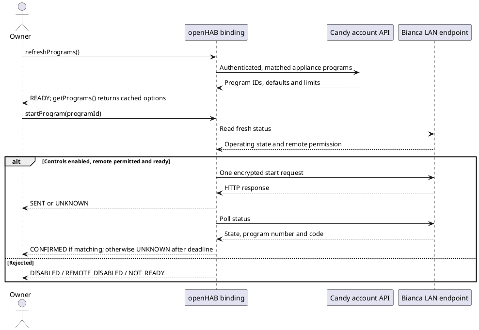

# Bianca Local Protocol

## Evidence

The implementation is based on static analysis of simply-Fi **3.14.1 (226)**, package `it.candy.simplyfi`.
APK SHA-256: `35df93c6e0b5883bee8cb066ba8ef35d3ee4c5e2af164e3a6b02675821718b03`.
The [reverse-engineering report](DEVE_README.md) documents the wider analysis and APK evidence.

The user's label identifies **BWM4 137PH6/1-S**, type **F3E1**, 1300 rpm.
No serial number is retained in these notes.
Firmware details and full wash-cycle comparisons remain unavailable.
An owner-authorized account lookup returned a supported key for the matching model, which successfully decrypted physical-device LAN status in openHAB 5.3.0-M3; credentials and keys are not retained in this documentation.
All committed fixtures are synthetic; they establish software behavior, not physical compatibility.

Source paths below are relative to the APK package `it/candyhoover/core/`:

| Source | Contract |
| --- | --- |
| `washer/axibianca/services/status/StatusService.java` | Local `GET http-read.json`, `encrypted=1`, XOR decoding before JSON parsing |
| `classes/utilities/CandySecurityUtility.java` | Repeated-key XOR; uppercase hexadecimal encoding; generated keys have length 16 |
| `models/appliances/CandyWasherStatus.java` | `statusLavatrice` wrapper and `NO_TIME_SET = 60000` |
| `models/appliances/CandyWasher.java` | Wire constants; status settings; `SpinSp < 100` multiplied by 100 |
| `washer/axibianca/model/Washer.java` | Bianca `PrNm` / `PrCode`; pause exclusion |
| `washer/axibianca/ui/activities/AbWasherHomeViewModel.java` | `establishedTimeText` adds `remainingTime` using `Calendar.SECOND` (13), confirming seconds in the app |
| `classes/utilities/CandyStringUtility.java` | Boolean true represented by `1` or `true` |

## Account-Assisted Key Retrieval

With no manual `encryptionKey`, a Thing uses its simply-Fi `username` and `password` to retrieve candidate keys.
The active Salesforce flow is used; the obsolete Heroku password grant is not used.
The implementation follows the APK's OAuth client ID, callback URI, brand header and metadata fields, and the independently published [Simply-Fi login implementation](https://github.com/zonya/candy-simplyfi/blob/main/custom_components/candy_simplyfi/api.py).
Authenticated authorization, token exchange and appliance enumeration were validated from Docker with openHAB 5.3.0-M3 libraries on 25 October 2026.
The account reported the matching BWM4 137PH6/1-S model, interface `Bianca`, connectivity `wifible` and one supported key candidate.
The runtime matched that key against the physical washer's encrypted LAN status, brought the Thing `ONLINE` and continued local polling using the cached key.

1. Request `/CandyApp/services/oauth2/authorize/expid_mobileCandy` with `response_type=hybrid_token` and a per-login OAuth state.
1. Preserve login cookies and hidden HTML form values, then submit credentials to the configured Candy login origin and path.
1. Follow a bounded sequence of HTTP or known JavaScript redirects; check the `candy://mobilesdk/detect/oauth/done` callback and its OAuth state.
1. Exchange the refresh token at `/CandyApp/services/oauth2/token` using `grant_type=hybrid_refresh`.
1. Read `/api/v1/appliances.json?with_programs=1` with the bearer token and `Salesforce-Auth: 1`.
1. Read missing key metadata from individual appliance documents when available; a failed optional enrichment does not discard keys already present in the inventory.
1. Try distinct, supported `encryption_key` values against one local status response and retain only a key that produces usable `statusLavatrice` data.

Each handler session owns an isolated HTTP client and cookie jar for account setup, reused across setup retries and stopped after each bootstrap operation.
Blocking account I/O runs on an openHAB worker pool; each request has a ten-second deadline, responses are capped at four MiB, and the whole operation has a two-minute deadline and request-count bound.
Login requests are restricted to the configured Candy origin and the known Candy Salesforce site; credentials are posted only to the original login origin and path.
API bearer tokens are sent only to the configured API origin, never to the LAN endpoint.
Cancellation aborts the active request and cancels queued work; the worker stops the owned client before finishing.
Keys and tokens are not published as Thing properties or persisted in Thing configuration.
Candidate keys are retained in the active session even when the washer is initially unreachable; local retries do not repeat account login.
The matching key is kept in the active session's configuration object; a restart or reconfiguration needs a new bootstrap unless a manual key is configured.
An optional account appliance ID restricts candidates; by default the LAN status response identifies the matching key without guessing from names or other optional metadata.

Normal monitoring remains local after bootstrap.
Temporary setup failures retry at least five minutes apart; authentication and invalid appliance-selection failures await a configuration change or explicit refresh.
MFA, consent or other unsupported interactive challenges produce a localized login error rather than being bypassed.

## Read Transport

The binding uses a configured host with fixed HTTP port 80 and route:

```http
GET /http-read.json?encrypted=1 HTTP/1.1
```

The key is not sent in the status URL.
Redirects are disabled.
Total request duration is limited to 1–10 seconds, with at most 65536 wire bytes buffered.
Only HTTP 200 is accepted as a status payload.
The shared openHAB HTTP client is not stopped or globally reconfigured.

After trimming outside whitespace, a response must be nonempty even-length hexadecimal.
The decoder XORs bytes with the repeating ASCII key and decodes the result as strict UTF-8.
The APK's decoder uses an intermediate character conversion; ASCII status fixtures are consistent with both implementations.
Non-ASCII status/command compatibility still needs appliance evidence.
Malformed hex, invalid UTF-8, invalid JSON and the wrong wrapper fail the read with sanitized errors.

Independent synthetic vector:

```text
key:       abcdefghijklmnop
plaintext: Write=1&StSt=0
hex:       36100A10005B564E3A1E3818505E
```

Explicit, opt-in controls use the same encoder with the fixed `/http-write.json` endpoint.

## JSON and Channels

The local root must contain a `statusLavatrice` object.
Cloud `appliance.current_status_parameters` is not a local fallback.
At least one supported field must yield a usable raw or normalized channel value; empty/unknown-only payloads fail.
Unknown additional fields are ignored.
Integer fields accept integral decimal JSON numbers or decimal strings, as the app reads scalars through its string accessor.
Malformed, overflowed or absent individual fields become `UNDEF`.

| Field | Interpretation |
| --- | --- |
| `MachMd` | 0 no state; 1 selection; 2 execution; 3 pause; 4 delay selection; 5 delayed execution; 6 error; 7 end |
| `PrPh` | 0 none; 1 prewash; 2 wash; 3 rinse; 4 last rinse; 5 end; 6 drying; 7 error; 9 good-night pause; 255 not applicable |
| `PrNm`, `PrCode` | Separate Bianca identifiers; string representation is preserved |
| `RemTime` | Seconds; negative values and the explicit 60000 sentinel are unknown |
| `Temp` | Program temperature setting in °C; negative and 255 values are unknown |
| `SpinSp` | Setting in hundreds of rpm when below 100, otherwise rpm; negative and 255 values are unknown |
| `WiFiStatus` | Remote permission: `1` / `true` enables, `0` / `false` disables; boolean text is case-insensitive; other values are unknown |
| `Err` | Scalar error identifier; missing does not imply zero |

Code fields are limited to 64 ASCII letters, digits, underscore or hyphen.
Boolean text is excluded from code fields regardless of case.
Known mode/phase codes have explicit normalized names; unknown numeric codes remain visible in the advanced channels.
Actual measurement fields such as `motS` and `NtcW` are not exposed.
Temperature/spin sentinel interpretation is conservative and still requires validation on the exact firmware.

Each response replaces the live snapshot: absent fields become unknown immediately.
No full-snapshot/partial-update guarantee has been verified on hardware; this policy avoids presenting an older value as a current observation.
`last-update` is a host receipt time after successful parsing, not a device timestamp.

## Scheduling and Lifecycle

Configuration is validated synchronously before creating a session or executor.
Invalid settings set `OFFLINE / CONFIGURATION_ERROR` with the localized validation message and return without scheduling work, contacting the account service or reading the device.
Offline status updates use the three-argument framework API because the detail-only overload is absent from openHAB 5.3.0-M3.
A validated handler lifecycle owns a sequential executor obtained from openHAB's `ThreadPoolManager`.
Session installation and invalidation share a short lock and generation check, so disposal during initialization cannot install a replacement session afterward.
Only short state/coordinator work runs there; HTTP operations are asynchronous.
All normal state publication and cleanup are ordered on that executor, without binding-owned locks around framework callbacks.
Disposal invalidates the session immediately, drains prior state delivery with a bounded five-second barrier, cancels requests/timers and shuts down only that session's executor.
Reentrant disposal from a framework callback cancels directly to avoid waiting on itself.
A stuck framework callback is reported as a disposal defect; network I/O cannot consume the drain period.

At most one request is in flight per Thing.
Refresh notifications coalesce, and request starts are separated by at least 15 seconds, measured using monotonic time.
Ordinary polling starts after completion plus `refreshInterval` seconds.
Consecutive failures back off to five minutes, retaining a longer configured interval; success resets backoff.
Live values are cleared after failure, while the successful timestamp remains until reinitialization.
Client and protocol failures translate `@text/` message references from the binding's language bundle in the JVM default locale when constructed.
`getMessage()` and the inherited `getLocalizedMessage()` return that stored text; the handler forwards it as the Thing status description.
Plain messages are accepted unchanged, and unresolved keys or unavailable translations preserve the original reference.
Message arguments and formatting are not supported; numeric HTTP status codes remain available in debug logging.
Production callers use fixed diagnostic references and keep response bodies and credentials out of messages.
`CandyAuthenticationException`, `CandyInvalidHostException` and `CandyApplianceSelectionException` distinguish failures that stop automatic retries; other `CandyProtocolException` failures retain communication-error recovery.
Transport failures, timeouts, unsuccessful HTTP statuses, an unavailable HTTP client and invalid payloads have distinct messages.
An invalid host, failed account authentication or invalid appliance selection is a configuration error and does not schedule an automatic retry.
Completion/execution wrappers are unwrapped before classification, and late failures from obsolete sessions are ignored.

## Command Gates

The APK has a dedicated Bianca command builder.
Stop uses `Write=1&StSt=0`, optional current `PrNm` and `DelVl=0` for delayed cancellation.
Start requires a complete model-specific program definition, encoded name, masks/defaults and exact parameter spellings.
The APK normal start builder includes the surprising `DispTestOn=1`; status uses `DisTestOn`.
That field and device acknowledgement semantics need call-site/Smali and real-traffic verification before enabling writes.

The implementation now provides opt-in local start/stop and read-only server catalog retrieval.
The owner's account returned 19 program entries for the matched Bianca on 25 October 2026.
`programs[].program.command_parameters[].command_parameter` contains `name` and `validation`; only recognized public program fields are retained.
The catalog is matched by the already verified local encryption key and requires interface `Bianca`; entries from other appliances are excluded.
A catalog refresh uses an isolated, cancellable account operation and does not alter local connection status.

The handler registers one prototype `CandyActions` Thing service per washer in the `candy` scope, with declarative references to openHAB's `TranslationProvider` and `LocaleProvider`.
Every Action exposes a String `result` for UI rendering, with messages resolved using the configured openHAB locale.
`getPrograms()` returns formatted JSON with a localized `message` and a `programs` array of public metadata; it never exposes start payloads, appliance identifiers or credentials.
Catalog and command status queries read volatile session snapshots without blocking or performing I/O.
`refreshPrograms()`, `startProgram(id)` and `stopProgram()` queue work on the captured session executor and share the channels' existing validation, rate limits and confirmation paths.
Request methods acknowledge submission to the current session executor; admission can still be rejected asynchronously by command validation, physical permission checks or catalog rate limits.
Inactive sessions return an unavailable message rather than a queue acknowledgement.
An empty program ID is rejected before submission.
Status Actions translate the latest cached codes; the monitoring channels retain the stable machine-readable codes.
Reconfiguration replaces these snapshots, and disposed actions clear the handler used for requests.
The original handler identity remains available to openHAB's late service-unregistration callbacks, including callbacks after DS deactivation; it cannot be used by the disposed Actions to submit commands.
Deactivation releases the translation services.
The Item-based command channels remain available.

The normal `Command.getParameterString()` Smali confirms the unconditional `DispTestOn=1` on the ordinary start path, matching the Java reconstruction.
This is reproduced as an app compatibility field; checkup, diagnostics and maintenance commands are not exposed.
Start uses selector/code/defaults from the matched server catalog, `DelVl=0`, zero option masks, `Dry=0`, `ED=0`, `RecipeId=0`, `StartCheckUp=0` and English `Lang=1` from `assets/language_mapping/languages.json`.
The ASCII server name is preserved through the app's missing-resource fallback; non-ASCII names and query delimiters cannot be started.
A temperature default of 255 omits `TmpTgt`; a spin default of 255 becomes zero, otherwise rpm is divided by 100.
The app's default steam is 1 for a fixed-steam family value of 4, and 0 otherwise; optional on/off steam is not enabled by default.
Off, tumbling and maintenance entries cannot be started through the normal program command.
Missing required defaults reject start rather than silently selecting zero.

Every write follows a fresh serialized local status read with `WiFiStatus` enabled.
Start requires an idle/finished mode; stop requires running, paused or delayed mode, and only mode 5 appends `DelVl=0` to cancel a delayed cycle.
The write is a bounded, cancellable `GET /http-write.json?encrypted=1&data=<hex>` with redirects disabled and no account credentials.
The app's command service uses HTTP success without a universal application acknowledgement, so the binding reports `SENT` rather than `ACCEPTED`.
Only subsequent device state confirms a command: start needs mode 2 with matching `PrNm`/`PrCode`, while stop needs mode 1 or 7.
Mode 0 (`NO_STATE`) does not establish readiness to start or confirmation of a stop.
A separate 60-second confirmation timer bounds the result even if further reads fail.
An ambiguous timeout never triggers replay through either transport.
Reconfiguration and disposal cancel queued reads, catalog fetches, writes and confirmation timers; commands are never persisted.
Physical actuation and full wash-cycle acceptance remain unverified.

The following PlantUML sequence shows catalog browsing and an explicit start:


