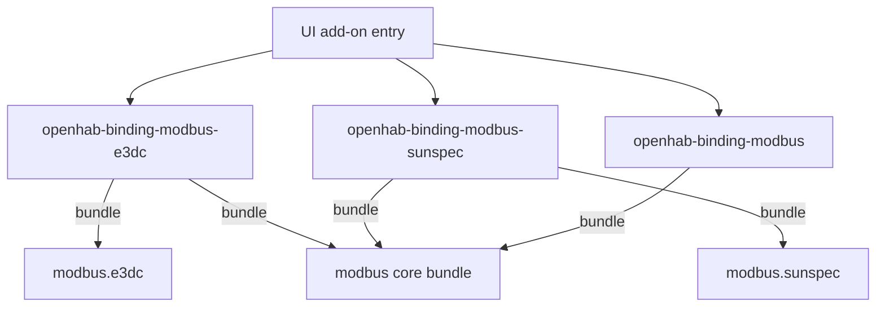

# ADR-001: Split Modbus Into a Core Add-on and One Add-on per Device

## Status

`Proposed`

## Context

The change `split-modbus-device-addons` (requirements "Core add-on without devices" and "One add-on per device") asks that users can install Modbus without every device extension.

Today every device is already a separate OSGi bundle (`org.openhab.binding.modbus.<device>`), but the distribution builds one hand-written feature `openhab-binding-modbus` in `features/openhab-addons/src/main/resources/footer.xml` that lists the core and all device bundles.
The per-bundle `feature.xml` files are excluded from the aggregated feature repository (`modbus*` exclusion in `features/openhab-addons/pom.xml`), and only the core bundle has an `addon.xml`.
The openHAB UI therefore shows a single "Modbus Binding" entry that installs everything.
Bluetooth and MQTT use the same aggregation pattern.

Facts that constrain the solution:

- All device bundles use the shared binding ID `modbus` for their thing types, so thing UIDs do not depend on the add-on ID.
- The "Add Thing" page of the Main UI (_Settings > Things > +_) takes the add-on ID as binding ID and lists only thing types whose UID starts with it. An add-on whose ID is not `modbus` therefore shows an empty page. This was found in a test on a real instance.
- Device bundles depend on the core bundle with scope `provided` and import its packages, so the core bundle must always be present when a device bundle is active.
- The jar files are small (roughly 50 to 100 KB each); the problem is the UI and thing type clutter, not disk space.

## Decision

We will expose the core and each device as an individual add-on:

- The core bundle gets the feature `openhab-binding-modbus-core` and the add-on ID `modbus-core` ("Modbus Core Binding"). The ID `modbus` stays with the all-in-one add-on (ADR-002), so installations that reference `modbus` keep working.
- Each device bundle gets its own `feature.xml` (feature `openhab-binding-modbus-<device>`) and its own `addon.xml` (ID `modbus-<device>`, name "Modbus <Device> Binding").
- Each device feature is self-contained and follows the existing `org.openhab.binding.mqtt.fpp` pattern: it lists the runtime base, the Modbus transport, the core bundle and its own bundle. Karaf installs a bundle only once, so no explicit feature dependency on the core feature is needed.
- The `modbus*` exclusion is removed from the feature aggregation so the per-bundle features become part of the add-on feature repository.
- Device add-on names start with "Modbus" so that they are grouped in the add-on list.
- The device add-ons keep their own IDs. Their entries in the list of installed bindings have an empty "Add Thing" page, as has the entry of the core, until the Main UI treats IDs with the prefix `modbus-` as the binding `modbus` (follow-up in openhab-webui). Workaround: open `/settings/things/add/modbus` or use a `.things` file.
- No Java, thing type or channel changes are made; the binding ID `modbus` stays.

Alternatives considered:

| Alternative | Why not |
|---|---|
| Keep one aggregated add-on | Does not meet the requirement. |
| Catalogue-driven generic binding with loadable device definitions | Architecture change with dynamic thing types; conflicts with generated i18n and the review conventions. Reconsider if the number of devices grows substantially. |
| Device bundles as external (marketplace) add-ons | Devices are no longer part of the official distribution and are harder to find. |

## Consequences

### Positive

- Users install only the devices they own; the thing type list stays short.
- Devices can be added or fixed without touching an aggregate list.
- Existing thing UIDs and item links stay valid.

### Negative

- About twelve more entries in the add-on list.
- Modbus deviates from the aggregation used by Bluetooth and MQTT; an upstream pull request needs the maintainers' agreement.
- Documentation must explain the new installation options.
- The entries of the device add-ons in the list of installed bindings are empty until the Main UI is changed.
- `mvn i18n:generate-default-translations` derives the thing type key prefix from the add-on ID. With the IDs `modbus-<device>` it generates keys such as `thing-type.modbus-e3dc.e3dc.label`, while the runtime looks up `thing-type.modbus.e3dc.label`. The existing hand-maintained files (`e3dc.properties`, `modbus.properties`) have the correct prefix and keep working, but the generated files are wrong and are not committed. Every run of the generator reports a difference until this is resolved (open decision).

## Diagram

